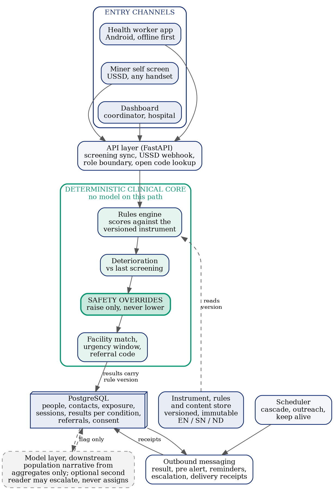
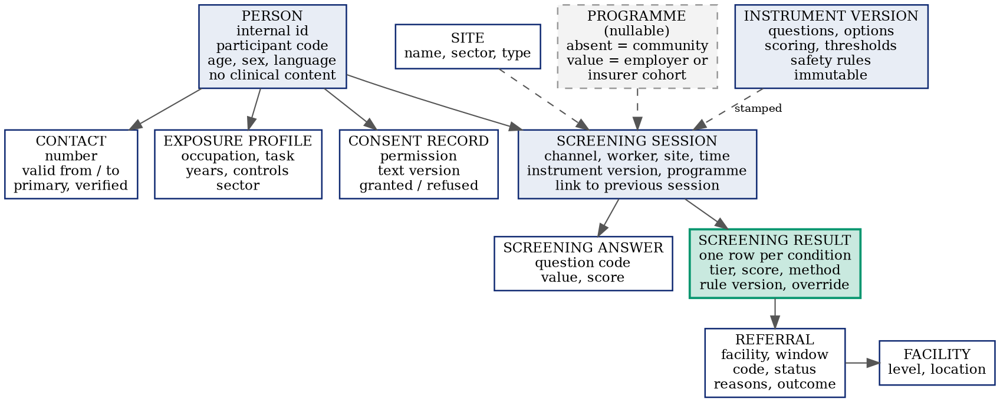
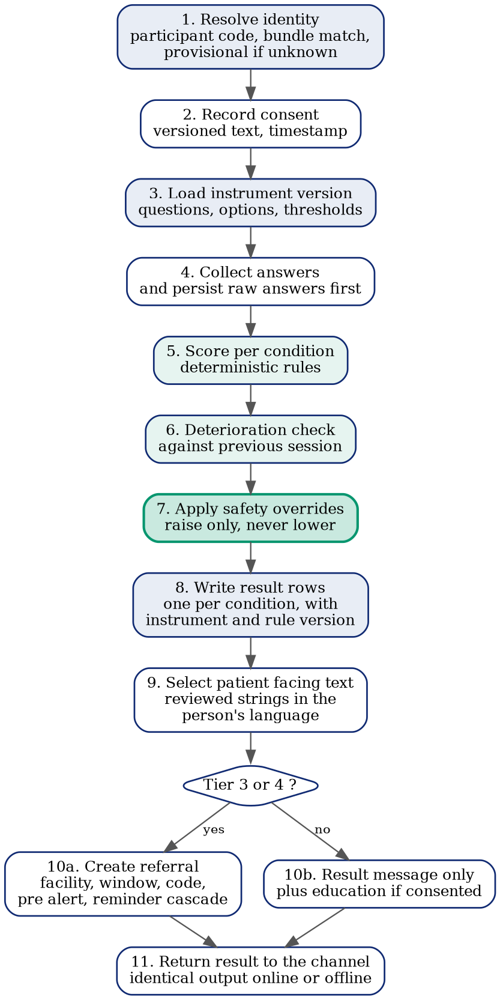
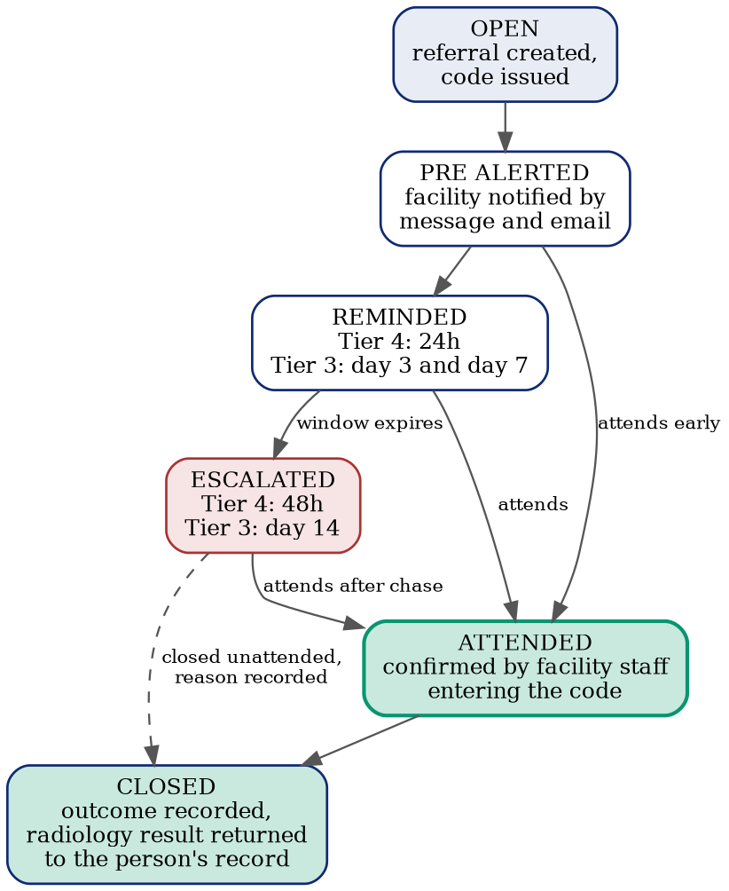

# Architecture

> Derived from `docs/master/MASTER_REFERENCE.md` §8, §9 and §10 (Master Reference v1.0, September 2026). The master document and its four figures are authoritative. If code and this document disagree, one of them is wrong and the disagreement is resolved before the next release rather than left standing.
>
> Status markers: **Built** = in the repository today, audited 18 September 2026. **Planned** = specified here, not yet built. Where the two differ, the gap is stated with the files it touches, because the audit that produced this document exists so that nobody has to rediscover it.

## Seven architectural principles

A developer facing an unforeseen choice reasons from these rather than guessing.

1. **The clinical path is deterministic.** No language model sits between a set of answers and a tier, on any channel, online or offline. A model may enrich, explain or flag; it may never decide.
2. **Offline is the normal case, not the exception.** Anything that only works online is a defect.
3. **Clinical logic is data, not code.** Questions, options, scores, thresholds and safety rules live in versioned tables. A clinical change is a data migration reviewed by the Clinical Lead, never a code deployment.
4. **Channels are equivalent.** Mobile and USSD read the same instrument and thresholds and must produce identical tiers from identical answers. Any difference is either specified deliberately or is a bug.
5. **Every clinical output is traceable.** A result row records instrument version, rule version, method and whether an override fired.
6. **Fail toward recording, never toward silence.** A downstream failure must never cause a screening to be lost. A screening that cannot be messaged is still a screening that happened.
7. **Identity is separated from clinical content.** Identifiers live apart from results with different access paths, so analysis runs on de-identified data by default.

**Against the code today**: principle 1 is violated on the mobile channel (Gemini assigns the base tier — see *The classification decision* below); 3 is violated everywhere (every clinical constant is hardcoded, in three copies); 4 is violated (three classifiers with three different thresholds); 5 has no schema support; 6 is violated on the one path that matters (`backend/routers/screening.py` deletes the screening when the model call fails); 7 is violated (`miners` holds phone, name and site on the same row the clinical rows key to). Principle 2 is partially met by the mobile offline queue.

## High-level architecture

Three entry channels feed one API layer. The API delegates to a deterministic clinical core, the only component permitted to assign a tier. Results, referrals and audit records go to a single relational store. Outbound messaging and the model layer both sit downstream of the store; neither can block a screening from completing.

| Layer | Responsibility | Rule that governs it |
|---|---|---|
| Channels | Collect answers, present results. Mobile, USSD, dashboard. | Presentation only. No clinical logic in a channel. A channel renders an instrument it receives as data. |
| API | Parse, authenticate where applicable, delegate, return. | Routers contain no business logic. |
| Clinical core | Score, compare, override, route. | Deterministic. Reads versioned rules. The only component that assigns a tier. |
| Data | People, exposure, sessions, answers, results, referrals, consent, content, audit. | Identified and clinical data separated. Every clinical row carries its rule provenance. |
| Outbound | Messaging with delivery receipts, facility pre-alerts, reminder cascade. | Asynchronous and retryable. A messaging failure degrades follow-up; it never loses a screening. |
| Model layer | Aggregate narrative, optional second reader, drafting support for reviewed content. | Non-blocking and downstream. Never on the clinical path. Always has a deterministic fallback. |
| Scheduler | Referral cascade, outreach announcements, database keep-alive. | Jobs idempotent and safe to run twice. |

**Built**: the thin-router/fat-service split (`backend/routers/` → `backend/services/`), the single relational store (PostgreSQL via Supabase in production, Alembic-managed), the three scheduler jobs (`backend/main.py`), the deterministic fallback on the narrative. **Not yet true**: the clinical core is not deterministic on the mobile channel, and clinical logic exists in the channels (`mobile/src/screens/QuestionScreen.js` carries the instrument and a scorer).

## The five irreversible decisions

The database holds only demonstration data. No consent has been taken. Nothing is under a data-protection obligation. In this state the schema can be rebuilt in a week. After the first real worker is enrolled under an ethics protocol, every schema change becomes a governance event. These five are addressed before any new feature work.

**One discipline holds all of this together: the word *silicosis* may appear in the database as a value. It may never appear as a column name.**

### 1. Data model — results as rows, not columns

**Rule**: a screening session produces zero or more results, one per condition assessed, as rows.

| Entity | Purpose |
|---|---|
| Person | Identity anchor. Renamed from *miner*. Identity only — no clinical content, no occupation, no site. |
| Contact | Numbers and other contact points with validity dates, primary flag, verification status. Many people may share a number. Never an identity key. |
| Exposure profile | Occupation history, tasks, years exposed, controls used, wet or dry. The block that changes when the system moves to a new sector. |
| Site | Renamed from *mine*; carries sector and type. Deliberately not a hard foreign-key target — informal workings are free text. |
| Screening session | The encounter: channel, administering worker, site, timestamp, instrument version, ruleset version, programme reference, link to previous session. |
| Screening answer | One row per question: code, value, score. |
| **Screening result** | **One row per condition**: condition, tier, score, confidence, method, ruleset version, whether an override fired. The single most important change. |
| Referral | Keyed to the driving *result*, not the session, with contributing reasons and (for the pilot) the clinical outcome. |
| Programme | Nullable on the session. Absent or `community` = outreach. A value = employer- or insurer-funded cohort. **This one nullable reference is the entire formal-sector seam.** No code may assume a session has no programme. |
| Facility | Receiving facilities with level and location. |
| Consent record | Layered permissions as data, with consent-text version and timestamp (`docs/SECURITY.md`). |
| Instrument and rules tables | Questions, options, scoring, thresholds, safety rules — versioned, immutable once approved (decision 3). |

**Current code**: `backend/db_models.py` — `screenings` carries `tier`, `risk_confidence`, `advice_line`, `ai_explanation_shona`, `ai_explanation_english`, `ai_contributing_factors`, `provisional`, `fallback_used` as columns (lines 87–95); `referrals.screening_id` keys to the session (line 137); `miners` holds `mine_site` (line 70); exposure and symptom answers are mixed in `screening_answers`; `mines` has no sector; no programme, consent, instrument or result tables. Nine tables, three migrations. **Affected by the rebuild**: `db_models.py`, `models.py`, all ten routers, every service reading `screening.tier`, `scripts/seed_demo_data.py`, `docs/API_CONTRACT.md`, `mobile/src/services/api.js`, `mobile/src/screens/ResultScreen.js` and `WorklistScreen.js`, `dashboard/app.js`.

### 2. Identity — phone number is an attribute, never a key

The hardest problem in the system and the one most likely to quietly destroy the headline metric. Handsets are shared, borrowed and sold; numbers change; a miner self-screening over USSD may be using his brother's phone. Two men merged into one record is far worse than two records for one man, because it cannot be detected by inspection.

- Telephone number becomes an attribute with history. No code may assume a number identifies a person.
- Every person receives an immutable internal identifier and a short human-readable **participant code** from the same unambiguous alphabet as referral codes, printed on a card. He presents it at the next outreach, keys it into USSD, and a clerk can read it aloud.
- Matching is on a bundle — hashed national ID where volunteered, name, age or date of birth, contacts, site — deterministic on the hash first, probabilistic on the rest, with **any probable match entering a human review queue**. Never merged automatically. Merges reversible from day one, keeping the losing record and who merged, when, on what evidence.
- Anonymous USSD: a supplied participant code attaches to that person; otherwise a **provisional identity flagged unverified**, resolved by a health worker at the next contact. Never silently attach a screening to whoever the number was last seen with.
- Biometrics considered and rejected for the pilot: consent and regulatory burden, hardware, and the surveillance perception that makes miners avoid a programme.

**Built, as of 1 November 2026.** `persons` and `contacts` (migration `0004`), the name and the provisional flag (`0007`), `backend/services/crypto.py`, `backend/services/identity.py` and `backend/routers/persons.py`. All four parts of the rule above are in code and tested: a six-character participant code; a telephone number as a `Contact` row with validity dates and no uniqueness anywhere; matching on the bundle with a deterministic hit on the hashed national identity number applied and **everything else queued for a human**; and a provisional identity for the anonymous USSD caller. Merges keep the losing record, record who, when and on what evidence, and reverse.

`resolve()` always returns a person a screening can be written against. That is deliberate: an uncertain identity produces a duplicate plus a queue entry, never a blocked screening — rule 7 and §8.2 agree that a duplicate is the failure to prefer.

Identifiers are stored twice, hashed for lookup and encrypted for use, because a number must be *found* (the USSD webhook arrives with a caller number) and also *sent to*. One consequence is worth knowing: a name encrypted at rest cannot be compared by edit distance, so fuzzy matching narrows the register on indexed hashes first and decrypts only that handful of rows, in memory (`docs/IMPLEMENTATION_PLAN.md` §12 item 16).

**Planned, and named rather than half-done**: `backend/services/ussd_handler.py:77-84` still attaches or creates a miner by phone — the exact shortcut this rule forbids. Deleting it before the USSD route is on v2 would break the only self-screening channel there is, so it goes with item 1.9, with `identity.py` already in place for it to call. `GET /api/workers/{phone}` and the mobile application's `resolveMinerId()` keep the same assumption until the v1 adapter (1.11).

**One flow is blocked, not forgotten.** The VHW application cannot yet confirm an identity at the next outreach: showing "is this the person?" needs the name, and `GET /api/v2/persons/{code}` requires a token, because public it would let anyone walk a six-character code space and harvest names and numbers. The application needs a device credential — item 1.13. Separately, any dashboard login can merge two people today, since there are only two flat accounts; a merge is a clinical safety event and belongs to one named role.

### 3. The instrument and rules as versioned data

Every clinical constant is a deployment away from silently changing and none is recorded against the result it produced. This is fatal for validation: to make any sensitivity or specificity claim, the system must state which instrument version and which ruleset version produced which tier for which person.

- **Instruments** with a version, a status (draft → review → approved → retired), an approver and a date.
- **Questions** per instrument version: clinical label, patient-facing wording per language, type, ordering, branching.
- **Answer options** with values, labels, scores.
- **Scoring rules** keyed to instrument version × condition × question code × answer value, so the same answer can weigh differently for silicosis and tuberculosis.
- **Tier thresholds** keyed to instrument version × condition.
- **Safety rules** as data, enforced by deterministic code running outside and after any model call.

An approved version is immutable. Every result stores both versions, without exception. A consequence: once thresholds are data, both channels read the same rows and cannot drift.

**Current code** — three copies of the instrument, three sets of thresholds:

| Rule | Backend | USSD | Mobile |
|---|---|---|---|
| Questions and scores | `backend/questions.py` | same file | `mobile/src/screens/QuestionScreen.js:18-113` (duplicate) |
| Tier thresholds | Gemini prompt text | `≥12` ORANGE, `≥6` YELLOW (`ussd_handler.py:47-75`) | `≤8 / ≤16 / ≤24` (`QuestionScreen.js:139-142`) |
| Safety overrides | 4 rules → RED (`safety_overrides.py:25`) | 4 rules → RED | **2 rules → ORANGE minimum only** (`QuestionScreen.js:146-148`); severe breathlessness and chest pain trigger nothing |
| Deterioration set | `deterioration.py:24` | not run | not run |
| Urgency windows | `referrals.py:17` | — | — |
| Cascade timings | `referral_cascade.py:36-37` | — | — |

No `instrument_version` or `ruleset_version` column exists anywhere.

### 4. Language — no runtime machine translation

**Rule**: no runtime machine translation of anything a worker reads or hears. Every patient-facing string is human-authored, clinically reviewed, versioned, and stored against a message code with one row per language. English, Shona and **Ndebele** from the start — Ndebele is not optional in this geography. Authored by a first-language health communicator, back-translated as a check, then comprehension-tested with miners.

**The character-set trap**: one character outside the GSM 7-bit alphabet forces a message from 160 to 70 characters per segment, permanently multiplying cost. A CI validator rejects any content string outside GSM-7, in every language.

**Forward hook**: content stored as codes with per-language variants means an audio-file reference per code and language is a single column later.

**Built, as of 1 November 2026** — the store, not the strings. `messages` and `message_texts` (migration `0006`), `backend/services/content_store.py`, and `GET /api/v2/content`, which serves the approved strings in one language for a client to cache. `render()` serves `approved` messages only, so unreviewed text is structurally unsendable rather than merely discouraged; an approved version is immutable; the GSM-7 and per-language budget checks run at load as well as in CI, from one shared definition in `backend/services/content_format.py`. A missing language falls back to the authored English and the response says so, because there is no translation step anywhere. There is no write route and will not be one: content enters through a migration from `content/` on a pull request the Clinical Lead approves, and `POST`/`PUT`/`PATCH`/`DELETE` return 405. The three strings that cannot come from the store are written down in `content/EXCEPTIONS.md`.

**The rule is now enforced by a test**, as the team decided on 18 September 2026. `backend/tests/test_content_runtime_rule.py` asserts on the import graph: the set of modules that may call a language model is pinned at exactly `population_intelligence` (aggregate, clinician-facing, with a deterministic fallback — permanent) and `ai_risk_engine` (a recorded defect, removed by item 1.9), and eleven patient-facing senders are asserted unable to reach either, transitively. A new model caller fails the build.

**Planned** — the strings themselves (item 1.6b). `content/messages/` holds the format example only, every message `draft`, every Shona and Ndebele entry an explicit "to be authored by a first-language health communicator" marker that a test keeps that way. The store is therefore **empty**, which is the correct state: English within budget is due Week 8 and the authored Shona and Ndebele Week 12 (`ROADMAP.md`), and the approval gate means the five services below cannot be rewired before then.

**Still true today**: the model's free text reaches a patient-facing surface — `mobile/src/screens/ResultScreen.js:300` renders Gemini's `explanation_english` and `:312` its `contributing_factors` on the health worker's screen, and both are persisted as patient-record text. This is the `strict` xfail in the test above, which flips to a hard failure the moment 1.9 lands. All patient-facing strings are still hardcoded Python and JavaScript dictionaries (`tier_messages.py`, `advice_engine.py`, `explanation_shona.py`, `education_messages.py`, `notifications.py:44`, mobile banners), English and Shona only, and `tier_messages.py:27-28` still hardcodes a facility name inside a clinical message. The backend's `explanation_shona` and `advice_line` are template-bound, which was partial compliance and remains so until they read from the store.

### 5. Consent and governance

Consent cannot be applied retrospectively. The consent model is a schema decision and must exist before the first real record. It is layered and recorded as data — screening and referral; longitudinal storage; contact by message; education broadcast; research and national statistics; and, separately and later, employer disclosure. The full permission table, the USSD keypress mechanism and the employer boundary are in `docs/SECURITY.md`.

**Built, as of 1 November 2026** — the mechanism, not the wording. `consent_texts` and `consent_records`, `backend/services/consent.py` and `backend/routers/consents.py`. The six permissions are a closed set; **absence is never consent**, so a permission nobody recorded reads as not granted with no default and no inheritance from a related permission or a programme; a record must name the *approved* consent text version the person was shown, because a row saying "agreed" with nothing attached is not evidence; and a withdrawal is recorded rather than deleted, so "granted, then withdrawn" stays distinguishable from "never granted". `employer_disclosure` cannot be granted at all — the §14.4 boundary exists in code before any commercial pressure exists to blur it.

The layering changes what the code does in one concrete place: a worker may accept screening and decline retention, and a declined retention means a session recorded with **no `previous_session_id`** and no deterioration comparison. The screening still happens and the result is still real; it simply has no history attached.

**Planned**: the consent *wording* (the Clinical Lead's, and consent capture is blocked until a text is approved — correct sequencing, not a gap); the USSD keypress consent screen and the worker-facing USSD/SMS opt-out (item 1.9, so withdrawal is staff-operated today); and wiring the gate into the v1 education broadcast, which needs the `miners`→`persons` mapping from the adapter (item 1.11).

**Still true today**: neither channel asks for consent, and `POST /api/education/broadcast` still sends without it. Phone numbers remain in plaintext in the v1 `miners` table until `0009` drops it. Two flat login roles and no read audit (item 1.13).

## The classification decision

**The deterministic clinical rule cascade is the tier of record, on every channel, online and offline.** Taken; not revisited without a recorded team decision.

The language model retains two honest roles: the population-level narrative on the dashboard from aggregate statistics, and optionally a **second reader** on an individual screening, permitted to raise a tier but never to lower one, with any disagreement logged for clinical review. Patient-facing explanation is template-bound and reviewed.

Why (the seven arguments): validation requires reproducibility; channel equivalence becomes trivial; the worst current failure mode disappears (a model failure deleting a screening); offline safety is restored (a worker told one tier by the device cannot be reclassified differently on sync); regulatory positioning improves; vendor risk leaves the clinical path; and it matches the strongest published precedent — CAPTURE is a transparent scoring rule published in a leading medical journal.

### What this does to the artificial-intelligence story

It makes it true. A prompted general model that has learned nothing from Zimbabwean miners is not a trained classifier. The honest four-stage roadmap:

| Stage | When | What is actually done |
|---|---|---|
| One | Now to pilot | No machine learning in classification. A deterministic, transparent, versioned instrument from validated components with hard safety overrides. The model produces aggregate narrative and reviewed explanation only. |
| Two | During the pilot | **Build the dataset.** Every referred worker who receives a chest X-ray produces a labelled example pairing answers and exposure history with a radiological outcome. No such dataset exists for this population anywhere. This is the real objective of the pilot. |
| Three | After the pilot | Fit a simple interpretable model, most likely logistic regression, on the labelled data. Weights from Zimbabwean data rather than clinical intuition; thresholds calibrated; coefficients published. Genuine, auditable machine learning that runs offline in microseconds. |
| Four | Year three and beyond | Cumulative exposure and trajectory modelling across multi-year repeat screenings and cross-sector work histories. |

**Engineering consequence for the pilot**: the referral loop must capture the radiological outcome and return it to the worker's record, not merely confirm attendance — a schema requirement, a hospital-workflow requirement and a Ministry conversation.

### Current code — three classifiers, none of them the cascade

- **Mobile online**: `backend/routers/screening.py:106` — Gemini's `tier` is the base tier; deterioration (line 143) and overrides (line 145) only ever raise it. For any miner without a red flag, the tier of record is what the model said. Gemini's `confidence`, `explanation_english` and `contributing_factors` are persisted and returned to the phone.
- **Mobile offline**: `mobile/src/screens/QuestionScreen.js:128-155` — different thresholds, weaker overrides. The queued screening is then re-classified by Gemini on sync (`mobile/src/services/offlineQueue.js:84` → `POST /api/screen`), so the tier the miner was told and the tier recorded can differ.
- **USSD**: `backend/services/ussd_handler.py:47-75` — deterministic thresholds, `confidence` fixed at 0.75, no deterioration check, no advice line, `fallback_used=1` on every screening.
- **Failure path**: `screening.py:106-131` — if Gemini fails after three attempts, the just-committed screening and its answers are deleted and a 502 returned. The miner was screened and is not recorded.
- **Second reader**: not implemented; no disagreement log.

## The screening pipeline

The order of operations for a single screening in the rebuilt system. Each step exists because of a specific failure the previous design allowed.

1. **Resolve identity** — participant code, bundle match, provisional if unknown.
2. **Record consent** — versioned text, timestamp.
3. **Load instrument version** — questions, options, thresholds.
4. **Collect answers and persist raw answers first.**
5. **Score per condition** — deterministic rules.
6. **Deterioration check** against the previous session.
7. **Apply safety overrides** — raise only, never lower. Last, so no earlier step and no model can be the final word on a red flag.
8. **Write result rows** — one per condition, with instrument and rule version.
9. **Select patient-facing text** — reviewed strings in the person's language.
10. Tier 3 or 4 → **create referral** (facility, window, code, pre-alert, reminder cascade); otherwise **result message only**, plus education if consented.
11. **Return the result to the channel** — identical output online or offline.

Failure behaviour is specified, not incidental. If messaging fails, the screening and referral stand and the message is retried with the failure recorded. If the device is offline, the full pipeline runs locally and the session is queued. A duplicate submission — mobile retry or gateway retry — is recognised by an **idempotency key** and does not create a second session. Under no circumstance is a completed screening discarded.

**Built today** (`backend/routers/screening.py`): persist-answers-first, deterioration before overrides, overrides last, referral creation, template-bound advice and Shona explanation. **Not built**: steps 1–3 and 8–9 as specified, per-condition scoring, idempotency keys, identical online/offline output.

## Referral lifecycle

Attendance is confirmed by **facility staff entering the referral code on an open lookup page**, which is what makes referral completion measurable rather than self-reported. Closing a referral should capture the radiological or clinical outcome and return it to the person's record — without that, the pilot produces an operational result and no labelled dataset.

**Built**: `open → pre_alerted → reminded → attended → closed → escalated` (`backend/services/referrals.py`, `referral_cascade.py`, `routers/referral_lookup.py`, `dashboard/lookup.html`); referral codes `SG-` + 4 characters from an alphabet excluding `0/O/1/I`, DB-unique; RED 48h / ORANGE 14 days; RED reminder at 24h, ORANGE at day 3 and 7, escalation at the window. **Not built**: outcome capture at close; referral keyed to a result row.

## Environments

| Environment | Purpose | Data | Who deploys |
|---|---|---|---|
| Local | Development on each engineer's machine. | Seeded synthetic data only. Never a copy of production. | Each engineer |
| Staging | Integration testing, demonstrations, stakeholder walkthroughs, device testing. | Reseeded synthetic data with a realistic tier distribution. | Automatic on merge to `main` |
| Production | The pilot and everything after it. | Real, consented, identified health data. Access restricted and audited. | Deliberate release from a tagged commit, by the backend owner |

Two absolute rules: production data is never copied into staging or onto a developer machine; all stakeholder demonstrations run against staging, never production.

**Current state**: one Render service, auto-deploying from `main`, is both production and the demonstration target. There is no staging. Model and gateway credentials are not separated per environment, so a test run could send a real message to a real number. This is Phase Zero/One work in `docs/STACK.md`.

## Non-functional requirements

| Requirement | Target | Why |
|---|---|---|
| USSD response time | Under 3 s per turn, hard ceiling well under 10 s | Gateways time out; a slow turn loses the screening |
| Total USSD session | Instrument completable within 180 s, with resumption if not | Network session limit |
| Screening data transfer | Under 5 KB per screening | Data cost is a real barrier for a field health worker |
| Installer size | As small as practical; any multi-megabyte dependency needs justification | Installation happens over borrowed connections |
| Offline capability | Full screening, scoring, result and referral generation with no connectivity | The mine site is the normal case |
| Floor device | Runs acceptably on the defined floor handset | "It works on my phone" is how field deployments fail |
| Screening duration | Target ten minutes, measured and reported as a distribution | A claimed figure that has never been measured is an overclaim |
| Availability during pilot | Backend reachable during outreach hours; offline covers gaps | Free-tier spin-down is visible and damaging; paid tier before pilot |
| Recovery point objective | No more than 24 hours of data loss | Daily automated backups with a tested restore |
| Recovery time objective | Service restored within one working day | A pilot can absorb a day, not an unrecoverable database |

## What the repository looks like today

The audited inventory as of 18 September 2026, for orientation. `docs/STACK.md` has the target layout.

| Component | State |
|---|---|
| Backend | FastAPI, Python 3.12.3, ten routers, sixteen services, 189 tests passing on `main` |
| Database | PostgreSQL via Supabase in production; SQLite locally and under pytest; nine tables; three Alembic migrations |
| Model | Gemini `gemini-3.1-flash-lite`, pinned; risk engine (3 attempts, 12 s timeout) and population narrative |
| Mobile | React Native / Expo, eight screens, AsyncStorage offline queue (unencrypted), own copy of the instrument and its own scorer |
| Dashboard | Static HTML/JS with Chart.js and Leaflet; two env-var accounts; hospital referral-code lookup page |
| USSD | Working decision tree; in-memory session dictionary; browser simulator at `/ussd-simulator` |
| Messaging | Seven SMS senders over Africa's Talking REST (sandbox endpoint); Resend email; every send logged, no delivery receipts |
| Scheduler | Referral cascade, outreach announcements, database keep-alive, in-process |
| Absent | `website/`, `clinical/`, `content/`, `diagrams/`, any CI, staging, consent, instrument tables, result rows, participant codes, Ndebele |
