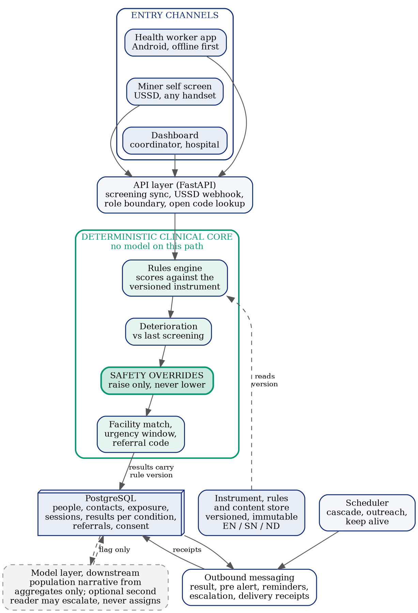
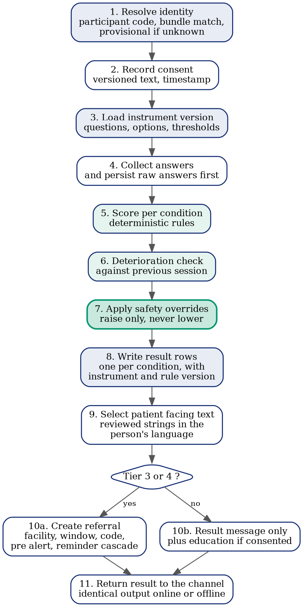
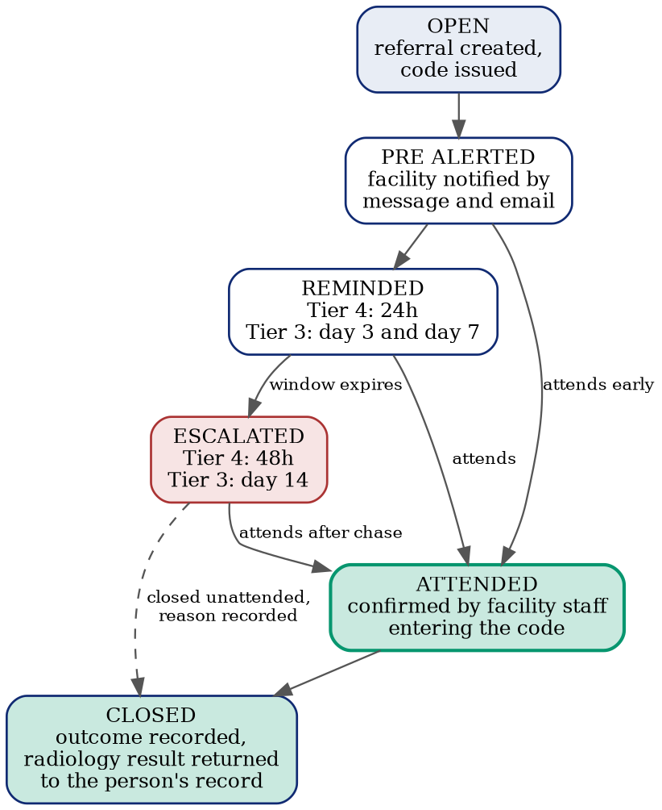
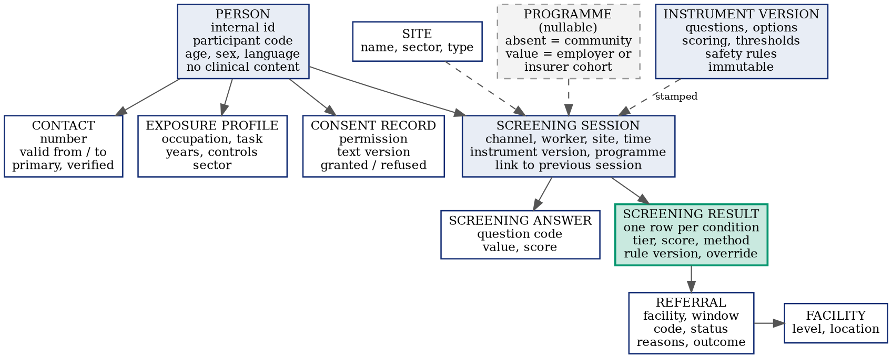

<!-- GENERATED from ../../SilicaGuard_Master_Reference_and_Roadmap.docx (v1.0, September 2026) by pandoc 3.11.
     The .docx is the source of truth. Do not edit this file; regenerate it:
       cd docs/master && pandoc ../../SilicaGuard_Master_Reference_and_Roadmap.docx -t gfm --extract-media=. -o MASTER_REFERENCE.md
     Run from this directory so image paths are file-relative (./media/...). -->

**SILICAGUARD**

*Screen. Track. Follow Through.*

**Master Reference and Development Roadmap**

From Healthathon Prototype to a National Lung Health Screening System

**Version 1.0**

September 2026

Prepared by Team SilicaGuard

Harare and Kwekwe, Zimbabwe

**Document Control**

This is the master reference document for SilicaGuard. It is the single
source of truth for the problem statement, the evidence base, the
architecture, the clinical instrument, the development roadmap, the
pilot design, the stakeholder strategy and the operating disciplines of
the team. Every deck, letter, application, social post and repository
document should be derived from this document rather than written
independently, and any figure that does not appear here should not be
used in public material until it has been added here with its source.

| **Field** | **Detail** |
|:---|----|
| Document title | SilicaGuard Master Reference and Development Roadmap |
| Version | 1.0 |
| Date | September 2026 |
| Status | Active working document. Supersedes all earlier roadmaps and reference documents. |
| Owner | Panashe M. Chandiwana, Team Leader and Founder |
| Clinical content owner | Gabriel, Clinical Lead |
| Mobile and interface content owner | Takudzwa, Mobile, Web and Design Engineer |
| Review cycle | Reviewed and versioned at the close of every phase, and whenever a locked decision changes. |
| Confidentiality | Internal. Contains unpublished figures, commercial strategy and stakeholder status. Do not circulate outside the team without removing Sections 18, 19 and 23. |

**How to use this document**

Sections 1 to 5 are stable. They describe what SilicaGuard is, the
problem it addresses and the evidence for that problem, and they change
only when new evidence arrives or when a strategic decision is
deliberately revised by the full team.

Sections 6 to 16 are the technical and clinical specification. They are
the basis for the repository documentation and should be mirrored into
the relevant markdown files as described in Appendix D.

Sections 17 to 25 are operational. They carry the roadmap, the timeline,
the budget, the stakeholder map and the risk register, and they will
change most often. Every change to a date, an owner or a budget line
should be made here first and then reflected elsewhere.

Appendices A to F are reference material, including the screening
instrument specification, the approved figures with their sources, and
the mapping between this document and the code repository.

**Contents**

> 1\. Executive Summary
>
> 2\. Identity, Mission and Objectives
>
> 3\. The Problem and the Evidence Base
>
> 4\. The Solution
>
> 5\. The Long Term Vision and the Three Axes of Expansion
>
> 6\. Where the System Actually Stands
>
> 7\. Evidence from Comparable Systems
>
> 8\. The Five Irreversible Decisions
>
> 9\. The Classification Decision
>
> 10\. System Architecture
>
> 11\. Technology Stack and Developer Guide
>
> 12\. The Clinical Screening Instrument
>
> 13\. Channel Engineering
>
> 14\. Data Governance, Security and Ethics
>
> 15\. The National Artisanal Miners Health Register
>
> 16\. Cyber Security Implementation
>
> 17\. Validation and the Research Agenda
>
> 18\. Stakeholder Engagement Strategy
>
> 19\. The Pilot
>
> 20\. Resources Required
>
> 21\. Team, Roles and Deadlines
>
> 22\. Development Roadmap and Timeline
>
> 23\. Sustainability, the Formal Sector and Integration
>
> 24\. Communications, Website and Education
>
> 25\. Risk Register
>
> Appendix A: Instrument Specification Template
>
> Appendix B: Approved Figures and Sources
>
> Appendix C: Stakeholder Tracker Template
>
> Appendix D: Mapping to the Code Repository
>
> Appendix E: Immediate Actions
>
> Appendix F: Letter Content Outlines

**1. Executive Summary**

SilicaGuard is an occupational lung health screening and referral system
built for Zimbabwe's artisanal and small scale mining communities. It
exists because more than half a million people in this country work in
conditions that reliably damage their lungs, produce most of the
national gold output, and sit outside every occupational health and
compensation system that exists. Nobody screens them, nobody tracks
them, and when a short donor funded outreach campaign does reach them,
the campaign ends and the tracking ends with it.

The system has two entry channels feeding one backend. A village health
worker can screen a miner on site in roughly ten minutes using a mobile
application that works without a network connection. A miner who misses
that visit can screen himself over USSD from any basic handset, with no
smartphone, no internet and no data bundle. Both channels produce the
same risk tier from the same clinical rules. High risk results generate
a referral to a real facility with a defined urgency window, a pre alert
to that facility, a reminder cascade, and a short referral code that
hospital staff enter to confirm the miner actually attended. That last
step is what makes referral completion measurable rather than assumed,
and referral completion is the metric this system is ultimately judged
on.

SilicaGuard won the Cimas Healthathon 3.0 in August 2026. What exists
today is a working prototype with a tested backend, a functioning mobile
application, a dashboard, and a USSD flow verified through a live
gateway. What does not yet exist is a system that has ever touched a
real patient. There is no ethics approval, no shortcode, no confirmed
message delivery to a physical handset outside a sandbox, no clinical
sign off on the instrument, and no validation of any kind. This document
is the plan for closing that gap.

The central strategic judgement in this document is that the team is
standing at the last moment when the expensive decisions are still
cheap. The database currently holds nothing but demonstration data. No
consent has been taken and no record is under a data protection
obligation. In that state the schema can be rebuilt in a week. Once the
first real miner is enrolled under an ethics protocol, every schema
change becomes a governance event involving real health records. The
roadmap is therefore organised around a single principle: do the
irreversible things first and defer everything reversible.

The second strategic judgement concerns scope. SilicaGuard is being
built for artisanal miners and for silicosis, and that focus is not
negotiable for the first phase. But it is being designed as the first
cell of a larger grid. The system grows along three independent axes,
which are the condition screened for, the sector exposed, and who
administers and pays for the screening. Keeping those axes separate in
the data model costs nothing today and is the difference between
expanding by configuration and expanding by reconstruction. The
destination is a national lung health screening system covering the
family of dust related lung disease across every sector where people
breathe harmful dust.

The third judgement concerns honesty about performance. The closest
rigorously validated analogue to this instrument anywhere in the world
achieved sensitivity below fifty percent in a well resourced setting.
SilicaGuard will not outperform it. What makes SilicaGuard valuable is
not accuracy against a clinical benchmark but coverage of a population
whose current level of screening is zero, combined with repeat screening
over time that catches what a single pass misses. This document commits
the team to reporting real numbers rather than aspirational ones, on the
grounds that credibility is the only asset a three person team cannot
rebuild once it is lost.

**2. Identity, Mission and Objectives**

**2.1 Name and motto**

The system is SilicaGuard. The motto is Screen. Track. Follow Through.
The three verbs are deliberate and they describe the three things the
system does and the order in which it does them. Screening without
tracking is what has already been tried in Zimbabwe and it did not work.
The third verb is the one that distinguishes this system from everything
that came before it.

**2.2 Mission**

To find the workers whose lungs are being damaged by dust before the
damage becomes irreversible, and to make certain that every one of them
who needs a doctor actually reaches one.

**2.3 Vision**

A Zimbabwe in which every person whose work exposes them to harmful dust
has a lung health record that follows them across employers, sectors and
years, and in which no worker develops advanced occupational lung
disease without ever having been screened.

**2.4 Positioning statement**

SilicaGuard is not a diagnostic tool and does not diagnose, treat or
replace clinical judgement. Hospitals diagnose silicosis, through
imaging and clinical assessment. SilicaGuard decides who gets on the
imaging list first and makes sure they turn up. It is the front end to
radiology, not an alternative to it, and it increases the yield of every
chest X ray taken by ensuring the right people reach the machine.

SilicaGuard does not replace Ministry of Health outreach or donor funded
campaigns. It is the layer that keeps working after the truck leaves.
The marginal cost of a single additional screening is a small number of
text messages, which is what makes continuous coverage possible where
episodic campaigns are not.

**2.5 Values and operating disciplines**

These five disciplines were established through the competition and the
stakeholder engagement that followed, and they apply to all future work
by every member of the team. They are not aspirational statements. They
are rules.

1.  Never state an unconfirmed figure as fact. Attribute it to its
    source, or flag it explicitly as unverified, or leave it out.

2.  Never claim a partnership that is not formally confirmed. SIRDC,
    NSSA and the Ministry of Health and Child Care are all organisations
    SilicaGuard is in early conversation with. None of them is a
    partner.

3.  Be explicit and precise about what is genuinely artificial
    intelligence and what is deterministic engineering. This distinction
    has been probed repeatedly by mentors and reviewers and is a core
    strength when answered honestly.

4.  Name gaps and limitations before being asked. This has consistently
    been treated as a credibility strength rather than a weakness.

5.  Keep the artisanal and small scale mining scope unless the full team
    has made and recorded a deliberate decision to expand it.

**2.6 Brand and visual identity**

The palette is navy, green and white. Navy is the primary colour and
carries authority and clinical seriousness. Green is the accent and
signals health and safety. White is the ground and keeps material
readable on low quality screens and in printed form.

| **Element** | **Specification** |
|:---|----|
| Primary navy | Hex 102A72. Headings, primary surfaces, logo ground. |
| Accent green | Hex 07966F. Accents, confirmations, calls to action. |
| Ground | White and a very light ice tint for alternating zones. |
| Typography in documents | Times New Roman, 12 point, 1.5 line spacing. |
| Risk tier colours | Green, yellow, orange and red internally. Never used alone. Every tier also carries a written label and an icon, because colour fails in sunlight, in print, on cheap screens and for colour blind users, and does not survive plain text messaging at all. |
| Tier naming at the message boundary | Level 1 to Level 4 in all text messages and USSD screens, because colour names do not carry meaning in plain text. |

**2.7 Objectives**

**Twelve month objectives**

- Rebuild the platform on a condition agnostic and sector agnostic data
  model before any real record exists.

- Produce a clinically signed off, versioned screening instrument with
  citations for every question and threshold.

- Obtain ethics approval and Ministry of Health engagement sufficient to
  screen real miners lawfully.

- Secure a USSD shortcode and a reverse billing arrangement so that self
  screening is free to the miner.

- Run a six month pilot in Kwekwe District and report a real referral
  completion rate against the 73 percent historical baseline.

- Produce the first labelled dataset of screening responses paired with
  radiological outcomes for this population.

**Three year objectives**

- Publish a peer reviewed validation study with a Zimbabwean university
  partner.

- Extend the instrument to tuberculosis and the wider pneumoconioses on
  the same platform.

- Launch the formal sector service as the sustainability mechanism that
  funds the free artisanal channel.

- Establish a governance structure for a national occupational lung
  health register with the Ministry of Health as steward.

**3. The Problem and the Evidence Base**

Every figure in this section is either sourced or explicitly flagged as
unverified. Appendix B repeats them in a single table for use in decks,
letters and applications. No figure should be used in public material
unless it appears in Appendix B.

**3.1 The population**

Zimbabwe has more than five hundred thousand artisanal and small scale
miners. Against roughly eighteen thousand workers in the formal gold
sector, that is a ratio of about twenty eight to one. This is not a
marginal population. It is the gold sector.

Artisanal and small scale miners produced approximately seventy five
percent of Zimbabwe's 2025 gold output, being 34.9 tonnes of a national
total of 46.7 tonnes, according to Fidelity Gold Refinery. Three
quarters of the country's gold is produced by people who have no
occupational health cover of any kind.

The mean age of affected miners is thirty five. These are people in the
middle of their working lives, with decades of exposure ahead of them
and dependants behind them.

**3.2 The disease burden**

Silicosis prevalence among artisanal miners is approximately nineteen
percent, based on a study of 3,821 miners published by Moyo and
colleagues in the International Journal of Environmental Research and
Public Health in 2022. Tuberculosis rates in this population run at
thirty nine times the national average, reported in the same journal in
2024.

Silicosis is incurable and irreversible. There is no treatment that
reverses the fibrosis. The only interventions that change outcomes are
early detection, which allows the exposure to be reduced and
complications to be managed, and prevention through dust control. This
is precisely why a screening and referral system matters more for this
disease than it would for a treatable one. Detection is the
intervention.

**3.3 The system that does not exist**

Artisanal miners are informal workers and are not covered by National
Social Security Authority occupational disease compensation. The
Pneumoconiosis Act and the compensation architecture that follows from
it were designed around formal employment, and this population falls
outside them entirely.

Zimbabwe has only two dedicated occupational health clinics nationally,
at Gweru and Gwanda provincial hospitals. There is no national database
of artisanal miners' occupational health. Zimbabwe has never implemented
the World Health Organization and International Labour Organization
Basic Occupational Health Services model, a gap confirmed in the
published report of the Kunda Nqob'iTB programme, which itself
recommended starting with artisanal mining districts.

**3.4 Why previous efforts did not solve it**

The best documented past effort is Kunda Nqob'iTB, a programme funded by
the United States Agency for International Development. It screened
10,668 miners over three years, an average of about 3,556 per year. At
that rate, screening the artisanal mining population once would take
approximately one hundred and forty one years. The programme folded when
its funding ended in 2024.

The more important failure is not reach but follow through. Only seventy
three percent of miners who needed follow up treatment completed it,
because referrals were not tracked. More than a quarter of the people
the programme successfully identified as needing care did not receive
it. That number, 73 percent, is the baseline that SilicaGuard's headline
metric is measured against.

Donor funding for this problem has collapsed twice in two years. A
separate grant of approximately fifty three million United States
dollars to Zimbabwe Health Interventions was terminated in 2025. A donor
funded mobile outreach ran in Shurugwi over roughly two weeks in July
and August 2026, following the same episodic model. The pattern is
consistent. Campaigns arrive, screen for a period, and leave, and the
tracking leaves with them.

**3.5 A figure that must not be used as fact**

A newsletter has reported approximately one death per week at Kwekwe
General Hospital, citing Dr Gunda, the hospital superintendent. The team
contacted Dr Gunda directly by text message and by email seeking
confirmation and had not received a reply at the time of writing. This
figure is therefore unverified.

Until confirmation is received in writing, this figure must be
attributed as something clinicians including Dr Gunda have reported,
must never be stated as a confirmed fact, and must not appear in any
social media post, poster, exhibition material or public document. A
related figure of fifty to sixty silicosis deaths per year in Kwekwe
District, which appeared in an earlier internal roadmap and was labelled
verifiable, is drawn from the same unconfirmed source and is subject to
the same restriction. A number attributed to a named hospital
superintendent who has not confirmed it is the single most damaging
thing this team could publish.

**3.6 The problem stated in one paragraph**

More than five hundred thousand Zimbabweans work in dust that causes an
incurable lung disease, produce most of the national gold output, are
covered by no occupational health or compensation system, are served by
two occupational health clinics nationally, appear in no national health
register, and have been reached only by episodic donor campaigns that
screened a small fraction of them, failed to follow a quarter of the
people they identified, and then stopped when the funding stopped.

**4. The Solution**

**4.1 What it does**

SilicaGuard takes a worker through a short structured screening, assigns
a risk tier using transparent clinical rules, compares the result to
that worker's own previous screening where one exists, and produces
either a health message or a referral. A referral carries a named
facility, a deadline, a text message to the worker, a pre alert to the
facility, a reminder cascade, and a short human readable code that
hospital staff enter on a lookup page to confirm attendance and close
the referral. The worker's record persists, so that the next screening
is a comparison rather than a fresh start.

**4.2 The two entry channels**

The mobile channel is a village health worker with an Android device at
a mine site. A fifteen minute group education session is followed by
individual screening taking roughly ten minutes each. The application
works entirely offline, scores locally, and synchronises when a
connection is available. This channel produces the higher quality data
because a trained person administers it and can probe an ambiguous
answer.

The USSD channel is a miner dialling a shortcode from any handset. The
same questions are presented through a numeric menu. There is no
smartphone requirement, no internet requirement and, once reverse
billing is in place, no cost to the caller. This channel is the reason
SilicaGuard reaches people that every smartphone based health tool
structurally excludes. It produces lower quality data than the mobile
channel and must be validated separately.

A third interface, the dashboard, serves coordinators, hospitals and
eventually national stakeholders. It is a consumer of the data rather
than a producer of it.

**4.3 The four modules**

These four modules are the functional core of the system. The
distinction between which of them use a language model and which are
deterministic engineering is stated precisely here and must be stated
precisely everywhere else.

| **Module** | **What it does** | **Method** |
|:---|----|----|
| 1\. Risk Stratification Engine | Assigns a risk tier from the screening answers, with hard safety overrides that can raise a tier but never lower one. | Deterministic clinical rules. See Section 9 for the decision to make this fully deterministic. |
| 2\. Longitudinal Deterioration Detection | Compares the current screening against the same worker's previous screening on a tracked subset of answers and escalates the tier on worsening. | Deterministic engineering. Not artificial intelligence and never described as such. |
| 3\. Referral Routing and Follow Through | Matches a facility, sets an urgency deadline, issues a referral code, pre alerts the facility, runs the reminder cascade and escalates on non attendance. | Deterministic engineering. Not artificial intelligence and never described as such. |
| 4\. Population Health Intelligence | Produces a narrative summary of aggregate screening activity for the dashboard, with a deterministic fallback if generation fails. | Genuine language model application, operating only on aggregate statistics and never on an individual clinical decision. |

A fifth function, patient facing explanation, uses a language model only
in a constrained and reviewed form as described in Section 9. Everything
else in the system, including the mobile interface, the dashboard,
message dispatch, the USSD decision tree, the outreach planner and the
education content, is engineering.

**4.4 The risk tiers**

| **Tier** | **Internal name** | **Message name** | **Meaning** | **Action** |
|:---|----|----|----|----|
| 1 | Green | Level 1 | No current symptomatic indicators. | Reinforce dust control and protective equipment. Routine re screen. |
| 2 | Yellow | Level 2 | Cumulative unprotected exposure or mild isolated symptoms. | Targeted education. Shortened re screen interval. |
| 3 | Orange | Level 3 | Core chronic symptoms present. Imaging indicated. | Referral with a defined window. Reminder cascade. |
| 4 | Red | Level 4 | Red flag indicators. Possible complicated disease or active tuberculosis. | Urgent referral within 48 hours with active tracking. |

Re screen intervals and referral windows per tier are specified in
Section 12 and remain subject to final clinical sign off.

**4.5 Scope decisions that are locked**

These decisions were made deliberately, several of them on mentor
advice, and one of them was the pivotal change that shaped the winning
submission. They are not reopened without an explicit, recorded, team
wide decision with new justification.

- No formal or enterprise mining in phase one. This scope change
  followed mentor feedback from Dr Bopoto and is the single most
  important strategic decision made to date. Formal sector integration
  is a designed future phase, covered in Section 23, not a current
  build.

- No chest X ray or imaging analysis. The system never interprets an
  image and never diagnoses.

- No WhatsApp. USSD and text messaging only, because the channel must
  work on handsets that cannot run an application.

- No QR codes. Replaced by a short human readable referral code that
  works over plain text and can be read aloud over a telephone.

- No voice or interactive voice response in phase one, although the
  content architecture leaves the door open for it because literacy is a
  real constraint in this population.

- No mercury toxicity module in phase one. Mercury exposure through
  amalgamation is a genuine and serious hazard for this exact population
  and is recorded here as a future clinical module, but it is a separate
  disease process requiring a separate evidence base and it is not part
  of the lung health instrument.

**5. The Long Term Vision and the Three Axes of Expansion**

SilicaGuard is being built to become Zimbabwe's lung health screening
system, covering every disease that dust causes in the lungs and every
sector in which people breathe it. Artisanal gold mining and silicosis
is the first cell of that grid and not a special case of it. The
distinction matters because it determines how the system is built today.

Growth happens along three independent axes. If these are collapsed into
a single notion of phase inside the code, moving along one axis disturbs
the others and each expansion becomes a rebuild. If they are kept
orthogonal, expansion becomes configuration.

**5.1 Axis one: condition**

Silicosis first, then tuberculosis, then the wider family of dust
related lung disease including the other pneumoconioses, chronic
obstructive pulmonary disease and lung cancer. Tuberculosis is the
natural second condition because the co morbidity with silicosis is
severe and already documented in this population, because the symptom
questions overlap almost entirely, and because national tuberculosis
programmes exist to receive referrals.

The engineering consequence is that a screening session must be able to
produce more than one result. A session yields zero or more results, one
per condition assessed, each with its own tier, score, method and rule
version. The shared symptom core is scored differently for different
conditions. This costs nothing to build now and is extremely expensive
to retrofit.

**5.2 Axis two: sector**

Artisanal and small scale mining first, then formal mining, quarrying
and stone crushing, then construction and road works, then foundries,
and then other dusty industries including tobacco processing. The
symptom questions barely change between these. What changes is the
exposure block, which is the set of questions about what the worker
actually does, for how long, and with what controls.

The engineering consequence is that exposure must be modelled separately
from symptoms, and that the entity being screened is a person and a work
history rather than a miner and a mine.

**5.3 Axis three: who administers and who pays**

Community outreach and self screening first, funded by grants and by the
cross subsidy described in Section 23. Then employer funded programmes,
then insurer funded programmes. This axis determines who may see what,
which is a governance question before it is a commercial one, and it is
addressed in Section 14.

The engineering consequence is a single nullable programme reference on
a screening session. Absent or set to community means outreach. A value
means an employer or insurer funded cohort with its own data ownership,
consent terms and reporting rules. One nullable field is the entire
formal sector seam. No features are built for it in phase one. The
discipline is simply that no code is written which assumes a session has
no programme.

**5.4 The record follows the worker**

This is the design principle that makes the long term asset possible and
it should be understood by every member of the team. A man panning gold
in Kwekwe this year may be on a construction site in Bulawayo next year
and in a formal mine the year after. His cumulative dust exposure is the
sum of all three. No institution in Zimbabwe currently holds that
picture for anyone.

A system organised around sites and employers can never hold it. A
system organised around people can. That is the difference between a
screening application and a national occupational health record, and
choosing the second costs nothing extra at this stage. It is also what
eventually makes cumulative exposure modelling possible, which is where
the register becomes scientifically valuable rather than merely
administratively useful.

**5.5 What SilicaGuard delivers against the Basic Occupational Health
Services model**

The World Health Organization and International Labour Organization
Basic Occupational Health Services model defines eight components of a
minimum occupational health service. SilicaGuard delivers six of them.
The two it does not deliver are physical clinical examination with
radiography, and workplace dust measurement. Both correctly remain with
hospitals and with the Ministry of Health and Child Care, and the system
is designed to hand off to them rather than to substitute for them.

This is a strong policy argument and it should be made explicitly in
engagement with the Ministry. Zimbabwe has never implemented this model.
SilicaGuard is a route to implementing most of it in the districts where
the need is greatest, at a marginal cost per worker of a few text
messages.

**6. Where the System Actually Stands**

This section is deliberately unflattering. Naming gaps before being
asked is the fourth operating discipline, and an accurate picture of the
starting point is the only basis on which a credible roadmap can be
built.

**6.1 What exists and works**

| **Component** | **State** |
|:---|----|
| Backend | Python and FastAPI, ten routers, service layer separated from routing, deployed on a free hosting tier. 189 backend tests passing as at 24 August 2026. |
| Database | PostgreSQL through a managed free tier, nine tables, migrations under version control. |
| Mobile application | React Native and Expo, eight screens, offline first with a local queue that retries on return to the home screen. |
| Dashboard | Static markup and vanilla script with charting and mapping libraries. Login, headline statistics, tier distribution, site breakdown, facility map, referral queue, outreach planner, miner directory with history, activity log. |
| Referral lookup | Unauthenticated code lookup and attendance confirmation pages so that hospital staff can close a referral without an account. |
| USSD | Working decision tree, verified through live gateway production servers on 23 August 2026, not only in sandbox simulation. |
| Messaging | Seven message senders through a messaging gateway REST interface, with every send written to an audit table. |
| Scheduler | Background jobs for the referral cascade, outreach announcements and database keep alive. |

**6.2 What is claimed or assumed but not true yet**

- No real patient has ever been screened. Every record in the system is
  demonstration data.

- No ethics approval. No screening of real people may lawfully or
  ethically take place until this is obtained.

- No USSD shortcode. The channel has been tested through a gateway but
  has no allocated code on any network, and no shortcode should be
  printed in any material until one is allocated.

- No confirmed message delivery to a physical handset outside the
  sandbox. Gateway acceptance is not delivery.

- No clinical sign off on the instrument or on patient facing text. All
  clinical content is draft.

- Teach Mode as designed, meaning illustrated in application education
  cards, is not built. Text message health tips are the working stand
  in.

- Demonstration data has been skewed at times and needs reseeding to a
  realistic distribution before any external demonstration.

- No validation of any kind. No sensitivity, no specificity, no
  comparison against radiological confirmation.

- Phone numbers are stored in plain text. This is an operationally
  driven decision that is documented but is not acceptable for real
  patient data.

- Data hosting is not in country, which is a data sovereignty gap
  relative to national policy expectations.

- Medical device classification with the Medicines Control Authority has
  not been formally determined. The system is designed to sit outside
  device classification and formal determination is a pre pilot
  checklist item. This must never be described as settled.

- No mine or worker location coordinates are captured. Only facilities
  have coordinates.

**6.3 Architectural weaknesses to be corrected**

- A screening produces exactly one tier, stored as columns on the
  screening row. This is silicosis shaped and blocks multi condition
  expansion.

- Telephone number is treated as the unique identity of a worker, which
  will produce false merges in a population that shares and changes
  handsets.

- The screening questions, the scoring, the thresholds and the safety
  overrides are all hardcoded, so none of them is recorded against the
  result it produced and none of them can be validated.

- The two channels classify differently, one through a language model
  and one through hardcoded thresholds, so they are effectively two
  different instruments.

- A failure of the language model deletes the screening and returns an
  error, which means a worker can be screened and then not recorded.

- USSD session state is held in an in memory dictionary, which does not
  survive a restart, does not work across more than one worker process
  and cannot support session resumption.

- Patient facing local language text is generated at request time by a
  language model, which means it cannot be clinically reviewed before it
  is sent.

**7. Evidence from Comparable Systems**

Six systems were examined to establish what has already been proven,
what has already failed, and what should be adopted rather than
reinvented. The findings changed several design decisions and one of
them changes how SilicaGuard should talk about its own performance.

**7.1 CAPTURE and the realistic performance ceiling**

CAPTURE, meaning COPD Assessment in Primary Care To Identify Undiagnosed
Respiratory Disease and Exacerbation Risk, is the closest analogue to
SilicaGuard that exists. It uses five symptom and exposure questions
and, for a subset of patients, a peak expiratory flow measurement,
scored to a threshold that triages patients toward further testing. That
is structurally the same instrument as SilicaGuard's.

It was developed over roughly a decade by a consortium including Weill
Cornell Medicine, the University of Michigan, National Jewish Health and
the University of Minnesota, and validated in a large prospective multi
centre study published in the Journal of the American Medical
Association. Among 4,325 primary care patients, spirometry identified
110 with clinically significant chronic obstructive pulmonary disease.
The CAPTURE tool identified 53 of them. Sensitivity was 48.2 percent and
specificity was 88.6 percent. The authors concluded that the tool had
low sensitivity and high specificity and that further research was
needed to optimise its performance.

Three conclusions follow, and they are the most important external
findings in this document.

1.  SilicaGuard's realistic performance ceiling is lower than the team
    has assumed. A ten question symptom instrument administered by a
    village health worker at a mine site, or self administered over a
    numeric keypad, will not outperform a decade of consortium work in a
    well resourced primary care setting. The roadmap plans for this
    rather than discovering it in the field.

2.  It is still transformative, and this is the argument to make.
    CAPTURE's comparator is a health system where spirometry is
    available and patients see doctors regularly. SilicaGuard's
    comparator is nothing at all. A tool that finds half of a population
    currently receiving zero screening changes outcomes. The same tool
    inside a functioning health system is marginal. That contrast is the
    honest and powerful claim.

3.  Repeat screening is the compensating mechanism for single pass
    sensitivity. A single screening at moderate sensitivity misses much.
    The same worker screened every six or twelve months, compared
    against himself, catches a meaningful share of what the first pass
    missed. The longitudinal module is therefore not a feature but a
    core part of the clinical rationale, and this argument should appear
    in the validation protocol and in stakeholder material.

**The peak flow question**

CAPTURE pairs its questionnaire with peak expiratory flow for a subset
of patients. Published work in India found that a peak flow meter
combined with a few symptom questions can be used effectively for
objective detection of obstructive airways disease where good quality
spirometry is unavailable.

A mechanical peak flow meter is inexpensive, needs no power and adds the
only objective measurement to an instrument that is otherwise entirely
self reported. It also brings real complications, including coaching for
correct technique, disposable mouthpieces for infection control, and
interpretation requiring reference values appropriate to this
population. It is recorded here as a formal evaluation question for the
pilot rather than a committed design change, and the decision belongs to
the Clinical Lead. Note also that peak flow measures airflow
obstruction, and early silicosis is a restrictive and radiological
process that may not show on it, so its value here may lie more in co
detecting chronic obstructive disease and in objective triage than in
silicosis detection itself.

**7.2 Check@ir and the case for validated instrument blocks**

Check@ir, from the Lovexair and Happyair organisations, is a digital
respiratory health assessment tool available in English, Spanish and
Portuguese that produces a personalised report for each participant, and
is explicit that the report is for guidance only and does not replace
diagnosis or follow up with a doctor.

The most valuable thing about it is not the technology but the
construction. It is built on published validated instruments, including
the Modified Medical Research Council dyspnoea scale, rather than on
invented questions. This is the single most useful adoption available to
SilicaGuard and it is a direct instruction to the Clinical Lead. Every
question taken from a validated instrument is a question that does not
have to be defended, that is already translated and studied, and that
makes SilicaGuard's results comparable with the published literature
instead of being a private scale nobody can interpret.

**7.3 Qure.ai and the reframing of the X ray argument**

Qure.ai's qXR product analyses a chest X ray in under sixty seconds,
identifies more than thirty findings, is cleared by the United States
Food and Drug Administration, carries European conformity certification,
has been evaluated by the World Health Organization for tuberculosis
screening, is deployed across more than three thousand one hundred sites
in over ninety countries, works with existing X ray machines and
operates offline with cloud synchronisation. In 2023 it was used to
screen more than one million patients for tuberculosis in Africa.

SilicaGuard will not compete with this and has correctly locked imaging
analysis out of scope. The strategic finding is that the two systems are
complementary rather than competing. Qure reads the X ray. SilicaGuard
decides who should get one and makes sure the person turns up. Qure's
own published work in Nigeria describes screening camps where consenting
individuals were screened for symptoms and received a chest X ray, which
is the episodic camp model that SilicaGuard's entire positioning is
built against. Someone still has to find people between camps and chase
referrals afterwards.

This produces two actions. First, the X ray argument is reframed.
SilicaGuard is not better than an X ray and does not attempt to be. It
is the front end to radiology, increasing the yield of every image taken
by ensuring the right people reach the machine and lowering the cost per
case found. That framing survives contact with a radiologist and is what
makes formal sector employers and insurers listen. Second, referral
payloads should be structured so that they could one day hand off
cleanly into an imaging workflow, including an artificial intelligence
assisted one. The integration is not built now, but the data shape
should not preclude it.

**7.4 LUDESC and Lung DT as cautionary examples**

LUDESC is a lung disease self screening system using a digital
stethoscope connected to a smartphone, with a ResNet50 one dimensional
model trained on the International Conference on Biomedical and Health
Informatics 2017 dataset, comprising 5.5 hours of recordings from 120
patients, reporting accuracy of 98 percent. Lung DT is a digital twin
framework using a YOLOv8 network to classify chest X rays into five
categories, reporting average accuracy of 96.8 percent on a public
dataset.

Both report accuracies far above the real world performance of the most
rigorously validated comparable tool, and the reason is that they are
evaluated retrospectively on curated public datasets rather than
prospectively in deployment. One hundred and twenty patients is not a
population. Neither system appears to be deployed at scale anywhere. The
Lung DT authors themselves acknowledge the need for comprehensive
datasets and models capable of handling real clinical scenarios.

The lesson is defensive and the team will need it. Somebody will
eventually ask why SilicaGuard does not use deep learning when published
papers report ninety eight percent accuracy. The prepared answer is that
those figures come from retrospective public datasets, that the closest
prospectively validated real world analogue achieved 48.2 percent
sensitivity, and that SilicaGuard would rather report a real number
honestly than a benchmark number that will not survive the field. That
answer earns more credibility than any accuracy claim could.

One idea from the digital twin literature is worth retaining for the
long term. Stripped of the terminology, a digital twin is a persistent
per person model updated by repeated measurement over time, which is
essentially what a longitudinal screening record is. Once SilicaGuard
holds several years of repeat screenings and exposure histories per
person, cumulative exposure and trajectory modelling becomes genuinely
possible and genuinely valuable. That is a destination, not a current
activity.

**7.5 The Australian silica screening tool**

The most directly relevant published work was not on the original list.
In the Australian state of Victoria, the regulator commissioned a
screening programme for workers in the stone benchtop industry following
an outbreak of silicosis. A multidisciplinary team built an electronic
data capture tool using the REDCap platform, designed for data entry by
both clinicians and the workers attending screening, and for systematic
collection of data for clinical and research purposes. The refined tool
was assessed as comprehensible to workers and capable of collecting
exposure data suitable for assessing silicosis risk, and was explicitly
designed to be adaptable including translation.

This is a regulator backed, published, silicosis specific occupational
exposure instrument with a usability study attached. The Clinical Lead
should read it before finalising the instrument. It is the best
available guide to structuring the exposure history, which is the one
block that cannot be taken from a validated symptom scale, and its
usability methodology is a template for testing the SilicaGuard form
with miners.

**7.6 The finding that validates the USSD channel**

In a Dutch study of a mobile self management application for chronic
obstructive pulmonary disease, 76.4 percent of patients had to be
excluded from participation, and 48.9 percent of those exclusions were
because of a lack of digital skills, access to a mobile device, or
access to the internet. That is in one of the wealthiest countries in
the world.

Every smartphone only lung health tool in the published literature
quietly excludes precisely the population SilicaGuard is built for. The
USSD channel is not a convenience feature or a fallback. It is the
reason this system reaches anybody at all, and it should be described
that way in every application, pitch and letter.

**8. The Five Irreversible Decisions**

The organising principle of this roadmap is that the team is standing at
the last moment when the expensive decisions are still cheap. The
database holds only demonstration data. No consent has been taken.
Nothing is under a data protection obligation. In this state the schema
can be rebuilt in a week. After the first real worker is enrolled under
an ethics protocol, every schema change becomes a governance event
involving real health records, every regretted field becomes a
migration, and changing the instrument mid study means re consenting
people or explaining to a regulator why the instrument moved.

Five decisions cannot be reversed later without disproportionate cost.
They are addressed first, before any new feature work. Everything else
in the system, including screens, dashboards, message wording, facility
lists, cascade timings, branding and even which conditions are screened
for, is comparatively cheap to change provided these five are right.

**8.1 Irreversible one: the data model**

The core defect in the current schema is that a screening produces
exactly one tier, stored as columns on the screening row. That is
silicosis shaped. Every future condition then becomes either another set
of columns or a rewrite of everything that reads a result.

The corrected model rests on one rule. A screening session produces zero
or more results, one per condition assessed, as rows rather than
columns.

**Entities**

| **Entity** | **Purpose and key points** |
|:---|----|
| Person | The identity anchor. Renamed from miner, because a construction worker or a tobacco grader is not a miner and the same individual moves between sectors. Holds identity only. No clinical content, no occupation, no site. |
| Contact | Telephone numbers and other contact points with validity dates, a primary flag and a verification status. Many people may share a number. One person may hold several over time. Never an identity key. |
| Exposure profile | Separated from the screening. Occupation history, tasks performed, years exposed, controls used, whether work is wet or dry. This is the block that changes when the system moves to a new sector, and it is why exposure must not be mixed into the symptom questions. |
| Site | Renamed from mine, and carries a sector and a type. Remains deliberately not a hard foreign key target, because informal workings are informal and many will be entered as free text. |
| Screening session | The encounter. Channel, administering worker, site, timestamp, instrument version, ruleset version and programme reference. |
| Screening answer | One row per question answered, carrying the question code, the recorded value and its score. |
| Screening result | One row per condition assessed. Condition, tier, score, confidence, method, ruleset version, whether a safety override fired. The single most important change in the whole schema. |
| Referral | Keyed to the driving result rather than to the session, and carrying the contributing reasons, so a referral can honestly record that it was driven by a high silicosis tier with a contributing tuberculosis tier. |
| Programme | Nullable on the session. Absent or community means outreach. A value means an employer or insurer funded cohort, carrying data ownership, payer, reporting entitlement and consent terms. This one nullable reference is the entire formal sector seam. |
| Facility | Receiving health facilities with level and location. |
| Consent record | Layered permissions recorded as data, with the consent text version shown and a timestamp. Covered in Section 14. |
| Instrument and rules tables | The screening instrument, its questions, options, scoring rules, thresholds and safety rules, held as versioned data. Covered in 8.3. |

One discipline holds all of this together and it is worth writing on the
wall of the workspace. The word silicosis may appear in the database as
a value. It may never appear as a column name. Follow that rule and the
day tuberculosis is added is a day of adding rows, not a day of
migrating patient records.

Timing. Cut the version two schema deliberately while the database still
contains only demonstration data, version the interface so that the
mobile application and dashboard move in step, and reseed. This is
roughly a week of work now and a governance event later.

**8.2 Irreversible two: identity**

This is the hardest problem in the system and the one most likely to
quietly destroy the headline metric, because both deterioration
detection and referral completion depend on reliably matching a worker
to his own earlier record.

The current design makes the telephone number the unique key on a
worker. In this population that fails in every direction. Handsets are
shared, borrowed and sold. Numbers change when a subscriber identity
module is lost. A miner self screening over USSD may be using his
brother's phone. The result is that two men are merged into one record,
which in health data is far worse than holding two records for one man,
because two clinical histories have been mixed and there is no way to
detect it by inspection.

**The four part approach**

1.  Telephone number becomes an attribute with history, never an
    identity. No code may assume a number identifies a person.

2.  Every person receives an immutable internal identifier and a short
    human readable participant code, drawn from the same unambiguous
    alphabet as the referral codes. The code is printed on a card and
    given to the worker. In low resource settings the cheapest and most
    reliable identity technology available is a card the person keeps in
    his pocket. He presents it at the next outreach, keys it into USSD,
    and a hospital clerk can read it aloud. It also gives him something
    tangible from an encounter that otherwise leaves him with nothing,
    which matters for return rates more than it sounds.

3.  Matching is done on a bundle and never merged automatically.
    National identity number where voluntarily given and stored as a
    hash, name, age or date of birth, contact numbers and site.
    Deterministic match on the hashed identity number first, then
    probabilistic matching on the remainder, with any probable match
    entering a human review queue rather than being applied. Duplicates
    are an annoyance that can be fixed later. A false merge is a
    clinical safety event. Merges must be reversible from the first day,
    keeping the losing record and recording who merged, when, and on
    what evidence.

4.  The anonymous USSD case is handled explicitly. If the caller
    supplies a participant code, attach to that person. If not, create a
    provisional identity flagged as unverified and let a health worker
    resolve it at the next contact. Never silently attach a screening to
    whoever the telephone number was last seen with. That single
    shortcut would corrupt the longitudinal dataset faster than anything
    else in the system.

Biometric identification was considered and deliberately rejected for
the pilot. It multiplies the consent and regulatory burden, requires
hardware, and introduces exactly the surveillance perception that makes
miners avoid a screening programme. Recording it as considered and
rejected with reasons is a stronger position with an ethics committee
than never having addressed it.

**8.3 Irreversible three: the instrument and rules as versioned data**

At present the questions live in a source file, the scoring lives in
code, the USSD thresholds are numeric literals, the safety overrides are
hardcoded, and the classification prompt is a text file. Every one of
these is a deployment away from silently changing, and none of them is
recorded against the result it produced.

This is fatal for validation. To make any sensitivity or specificity
claim, and Professor Mushiri has explicitly asked for tier specific and
channel specific versions of exactly that, the system must be able to
state which instrument version and which ruleset version produced which
tier for which person. If a threshold moves in a code commit, every tier
assigned before that commit becomes uninterpretable and the rule in
force cannot be reconstructed.

**The structure**

- Instruments, with a version, a status moving from draft through review
  to approved and eventually retired, and a recorded approver with a
  date.

- Questions belonging to an instrument version, with their clinical
  label, their patient facing wording in every supported language, their
  type, their ordering and their branching conditions.

- Answer options with values, labels and scores.

- Scoring rules keyed to instrument version, condition, question code
  and answer value, so that the same answer can carry different weight
  for silicosis than for tuberculosis.

- Tier thresholds keyed to instrument version and condition.

- Safety rules held as data, while the engine that enforces them remains
  deterministic code running outside and after any model call.

Two properties make this safe rather than fragile. An approved version
is immutable, so a change creates a new version and never edits an
approved row. And every screening result stores the instrument version
and ruleset version that produced it, without exception.

A useful consequence follows. Today the two channels classify
differently and would have to be validated separately with no way to
compare them. Once thresholds are data, both channels read the same rows
and cannot drift apart.

**8.4 Irreversible four: language**

The current approach, asking a language model to translate English
explanations into Shona at request time, is removed entirely. The reason
is not only that the output reads poorly. It is that text which does not
exist until the moment it is sent cannot be clinically reviewed, and
every patient facing string in a health system must be reviewable before
it is used.

**The rule**

No runtime machine translation of anything a worker reads or hears.
Every patient facing string is human authored, clinically reviewed,
versioned, and stored against a message code with one row per language.

This delivers four things at once. The Clinical Lead can review the
exact words that will reach a person. The team can demonstrate to an
ethics committee what was said. A new language is added by adding rows
rather than by changing code. And the quality problem disappears,
because the text is written by a speaker of the language rather than
translated into it by a machine.

**Languages**

English, Shona and Ndebele from the start. Ndebele is not optional in
this geography. The Midlands is genuinely mixed, and one of the
country's only two dedicated occupational health clinics is at Gwanda.
Adding a third language to an architecture that assumes two is painful.
Adding it to one designed for many is data entry.

**Quality method**

The reason current local language output reads as broken is register
rather than vocabulary. Health messaging translated word by word from
English is parseable and alien. The method is to have a first language
health communicator author rather than translate, then back translate to
English independently as a check, then run a comprehension test with
actual miners in which the message is read aloud and the listener is
asked to say back what it means. That last step costs a day, and it is
exactly the kind of evidence that strengthens an ethics submission and a
validation dossier.

**The character set trap**

A text message in the standard GSM seven bit alphabet carries 160
characters per segment. A single character outside that alphabet forces
the entire message into a sixteen bit encoding at 70 characters per
segment. One curly apostrophe pasted out of a word processor therefore
doubles or triples the cost of every message sent, permanently. A
validator in the continuous integration pipeline must reject any content
string containing a character outside the GSM seven bit set, and it must
run against every language.

**Forward hook**

Voice and interactive voice response remain out of scope, but literacy
is a genuine constraint in this population. Because content is stored as
codes with per language variants, adding an audio file reference per
code and language later is a single column. The door is left on its
hinges even though it stays shut.

**8.5 Irreversible five: consent and governance**

Consent cannot be applied retrospectively to records collected without
it, and parts of this are legal obligation rather than best practice.
The team is not legally qualified and a lawyer must confirm the
specifics, but the shape is clear and is set out in Section 14. The
essential point for this section is that the consent model is a schema
decision and must exist before the first real record.

Consent is layered and recorded as data rather than assumed, separating
screening and referral as the core service, storage in a longitudinal
record, contact by text message, use of de identified data for research
and national statistics, and separately and later, any disclosure to an
employer.

That last permission deserves emphasis here because it is architectural
rather than commercial. If an employer pays, the employer must never
receive individual results without separate, specific and refusable
consent from the worker. The employer receives aggregate exposure and
risk intelligence. Any individual fitness to work communication goes
through a clinician and not through an interface. Building that boundary
into the programme model now, before any commercial pressure exists,
makes the formal sector module defensible to a union, a ministry and an
ethics committee. Building it later, under contract pressure from a
paying employer, means losing that argument. It is also a commercial
strength, because it is the reason workers will answer honestly rather
than concealing symptoms to protect their jobs, and honest answers are
what makes the employer's data worth buying.

**9. The Classification Decision**

**9.1 The decision**

The deterministic clinical rule cascade is the tier of record, on every
channel, online and offline. This decision is taken and is not revisited
without a recorded team decision.

The language model retains two honest roles. It produces the population
level narrative on the dashboard from aggregate statistics. And it may
act as a second reader on an individual screening, permitted to raise a
tier but never to lower one, with any disagreement logged for clinical
review. Patient facing explanation is template bound and reviewed, as
described in Section 8.4.

**9.2 Why**

The Clinical Lead's tier specification is expressible entirely as
boolean logic over answer values. There is no step in the cascade that
requires a language model and no step where a model adds information the
rules do not already contain. Beyond that, seven arguments make the
decision clear.

1.  Validation requires reproducibility. A classifier whose output
    varies between calls cannot be validated in the ordinary sense, and
    validation is the single thing that converts this prototype into
    evidence.

2.  Channel equivalence becomes trivial rather than a research question.
    Both channels read the same threshold rows and cannot drift.

3.  The worst current failure mode disappears. Today a model failure
    deletes the screening and returns an error, meaning a worker can be
    screened and then not recorded. That is unacceptable with real
    patients.

4.  Offline safety is restored. Under the current design a worker can be
    screened offline, told one tier by the device, and then reclassified
    differently when the device synchronises, leaving a man who was told
    he was fine and a record that says otherwise. A single deterministic
    engine removes this entirely.

5.  Regulatory positioning improves. A deterministic rule based triage
    instrument sits far more comfortably outside medical device
    classification than a language model classifier does.

6.  Vendor risk disappears from the clinical path. Models are deprecated
    and their behaviour changes without notice. Clinical rules do not.

7.  It matches the strongest published precedent. CAPTURE is a
    transparent scoring rule and it is published in a leading medical
    journal. Rule based is not the weaker position. It is the position
    the most rigorous comparable instrument in the world occupies.

**9.3 What this does to the artificial intelligence story**

It improves it, because it makes it true. The current claim that the
risk engine is artificial intelligence is weak under examination,
because a prompted general model that has learned nothing from
Zimbabwean miners is not a trained classifier. Replacing that claim with
an honest four stage machine learning roadmap is a stronger position in
every room the team will enter.

| **Stage** | **When** | **What is actually done** |
|:---|----|----|
| Stage one | Now to pilot | No machine learning in classification. A deterministic, transparent, versioned instrument assembled from validated components with hard safety overrides. The model produces aggregate narrative and reviewed explanation only. |
| Stage two | During the pilot | Build the dataset. Every referred worker who receives a chest X ray produces a labelled example pairing screening answers and exposure history with a radiological outcome. No such dataset exists for this population anywhere. This is the real objective of the pilot and the real long term asset. |
| Stage three | After the pilot | Fit a simple interpretable model, most likely logistic regression, on the labelled data. Derive weights from Zimbabwean data rather than clinical intuition, calibrate thresholds to the chosen sensitivity and specificity trade off, and publish the coefficients. Genuine machine learning, auditable, running offline in microseconds on a cheap handset, and the same method that underlies CAPTURE. |
| Stage four | Year three and beyond | Cumulative exposure and trajectory modelling across multi year repeat screenings and cross sector work histories. This is where the national register becomes scientifically valuable and where a more sophisticated model would finally be warranted. |

The engineering consequence for the pilot is specific and must not be
missed. The referral loop must be designed to capture the radiological
outcome and return it to the worker's record, not merely to confirm
attendance. That is a schema requirement, a hospital workflow
requirement and a Ministry conversation, and it needs to be in the
design from the beginning.

**10. System Architecture**

This section is the architectural reference for developers. The diagrams
are authoritative. If code and diagram disagree, one of them is wrong
and the disagreement is resolved before the next release rather than
left standing.

**10.1 Architectural principles**

Seven principles govern every design decision in this system. They are
listed here so that a developer facing an unforeseen choice can reason
from them rather than guessing.

1.  The clinical path is deterministic. No language model sits between a
    set of answers and a tier, on any channel, online or offline. A
    model may enrich, explain or flag, and it may never decide.

2.  Offline is the normal case, not the exception. The mobile channel is
    designed for a mine site with no coverage. Anything that only works
    online is a defect in this context.

3.  Clinical logic is data, not code. Questions, options, scores,
    thresholds and safety rules live in versioned tables. A clinical
    change is a data migration reviewed by the Clinical Lead, never a
    code deployment.

4.  Channels are equivalent. The mobile application and USSD read the
    same instrument and the same thresholds and must produce identical
    tiers from identical answers. Any behaviour that differs between
    channels is either specified deliberately or is a bug.

5.  Every clinical output is traceable. A result row records the
    instrument version, the rule version, the method and whether an
    override fired. Nothing clinical is ever produced by logic that
    cannot be named afterwards.

6.  Fail toward recording, never toward silence. A downstream failure
    must never cause a screening to be lost. A screening that cannot be
    messaged is still a screening that happened, and the record is
    preserved and retried.

7.  Identity is separated from clinical content. Identifiers live apart
    from results, with different access paths, so that analysis can run
    on de identified data by default.

**10.2 High level architecture**

Three entry channels feed one API layer. The API delegates to a
deterministic clinical core which is the only component permitted to
assign a tier. Results, referrals and audit records are written to a
single relational store. Outbound messaging and the model layer both sit
downstream of the store and neither can block a screening from
completing.

*Figure 1. SilicaGuard high level architecture. The clinical core is
deterministic and the model layer is downstream and non blocking.*

| **Layer** | **Responsibility** | **Rule that governs it** |
|:---|----|----|
| Channels | Collect answers and present results. Mobile application, USSD, dashboard. | Presentation only. No clinical logic is implemented in a channel. A channel renders an instrument it receives as data. |
| API | Parse, authenticate where applicable, delegate, return. Thin by design. | Routers contain no business logic. All logic lives in the service layer so that both channels reach it identically. |
| Clinical core | Score, compare, override, route. | Deterministic. Reads versioned rules. The only component that assigns a tier. |
| Data | Persist people, exposure, sessions, answers, results, referrals, consent, content and audit. | Identified and clinical data separated. Every clinical row carries its rule provenance. |
| Outbound | Messaging with delivery receipts, facility pre alerts, reminder cascade. | Asynchronous and retryable. A messaging failure degrades follow up, it never loses a screening. |
| Model layer | Aggregate narrative, optional second reader, drafting support for reviewed content. | Non blocking and downstream. Never on the clinical path. Always has a deterministic fallback. |
| Scheduler | Referral cascade, outreach announcements, database keep alive. | Jobs are idempotent and safe to run twice. A missed run must be recoverable by the next run. |

**10.3 The screening pipeline**

This is the order of operations for a single screening in the rebuilt
system. The order is deliberate and each step exists because of a
specific failure that the previous design allowed.

*Figure 2. Screening pipeline. Answers are persisted before scoring, and
overrides run after every other step.*

Three points in this sequence carry most of the safety weight. Answers
are persisted before any scoring occurs, so that a downstream failure
can never lose what the worker actually reported. Safety overrides run
last, after both scoring and deterioration escalation, so that no
earlier step and no model can be the final word on a red flag. And the
result returned to the channel is the same whether the device was online
or offline, because the same deterministic engine produced it in both
cases.

Failure behaviour is specified rather than incidental. If messaging
fails, the screening and the referral both stand and the message is
retried, with the failure recorded. If the device is offline, the full
pipeline runs locally and the session is queued for synchronisation. If
a duplicate submission arrives, whether from a mobile retry or a gateway
retry, it is recognised by an idempotency key and does not create a
second session. Under no circumstance is a completed screening
discarded.

**10.4 Referral lifecycle**

The referral state machine is where the headline metric is produced.
Attendance is confirmed by facility staff entering the referral code on
an open lookup page, which is what makes referral completion measurable
rather than self reported.

*Figure 3. Referral lifecycle. Attendance is confirmed by the facility,
not by the worker.*

One addition to the closing state matters for the machine learning
roadmap in Section 9. Closing a referral should capture the radiological
or clinical outcome and return it to the person's record, not merely
mark that they attended. Without that, the pilot produces an operational
result and no labelled dataset. With it, every completed referral is a
training example that nobody else in the country holds.

**10.5 Data model**

The entity structure below implements the decisions in Section 8.1. The
single most important feature is that a screening session produces
result rows, one per condition, rather than a tier column.

*Figure 4. Core entities. The nullable programme reference is the entire
formal sector seam.*

**10.6 Environments**

| **Environment** | **Purpose** | **Data** | **Who deploys** |
|:---|----|----|----|
| Local | Development on each engineer's machine. | Seeded synthetic data only. Never a copy of production. | Each engineer |
| Staging | Integration testing, demonstrations, stakeholder walkthroughs, device testing. | Reseeded synthetic data with a realistic tier distribution. | Automatic on merge to the main branch |
| Production | The pilot and everything after it. | Real, consented, identified health data. Access restricted and audited. | Deliberate release from a tagged commit, by the backend owner |

Two rules about environments are absolute. Production data is never
copied into staging or onto a developer machine, because that is the
most common route to a health data breach in small teams. And all
stakeholder demonstrations run against staging, never against
production, so that a demonstration can never create, alter or expose a
real record.

**10.7 Non functional requirements**

| **Requirement** | **Target** | **Why this number** |
|:---|----|----|
| USSD response time | Under 3 seconds per turn, hard ceiling well under 10. | Gateways time out. A slow turn ends the session and loses the screening. |
| Total USSD session | Instrument completable within 180 seconds, with resumption if it is not. | Network session limit. Resumption covers the slower users who matter most. |
| Screening data transfer | Under 5 kilobytes per screening. | Data cost is a real barrier for a health worker in the field. |
| Installer size | As small as practical, with any dependency adding several megabytes requiring justification. | Installation happens over borrowed connections. |
| Offline capability | Full screening, scoring, result and referral generation with no connectivity. | The mine site is the normal case. |
| Floor device | Runs acceptably on the defined floor specification handset. | It works on my phone is how field deployments fail. |
| Screening duration | Target ten minutes, measured and reported honestly as a distribution. | A claimed figure that has never been measured is an overclaim. |
| Availability during pilot | Backend reachable during outreach hours, with offline operation covering any gap. | Free tier spin down is visible and damaging. Paid tier before pilot. |
| Recovery point objective | No more than 24 hours of data loss in the worst case. | Daily automated backups with a tested restore. |
| Recovery time objective | Service restored within one working day. | A pilot can absorb a day. It cannot absorb an unrecoverable database. |

**11. Technology Stack and Developer Guide**

This section tells a developer joining the project what to use, why it
was chosen, who owns it and how to get access. It is also the checklist
for anything that must be provisioned or paid for. Where a choice is
provisional, that is stated rather than hidden.

**11.1 The stack**

| **Layer** | **Technology** | **Owner** | **Notes and version policy** |
|:---|----|----|----|
| Backend language | Python | Panashe | Pin the minor version in the runtime configuration. Upgrades are deliberate, not incidental. |
| Backend framework | FastAPI | Panashe | Thin routers, service layer holds logic, request and response schemas validated. |
| Data access | SQLAlchemy with Alembic migrations | Panashe | Every schema change is a reviewed migration. No manual changes to a live database, ever. |
| Database | PostgreSQL | Panashe | Managed hosting. Connection pooling with pre ping, because idle poolers drop connections. Sovereignty decision in Section 14.5. |
| Backend hosting | Managed container hosting | Panashe | Paid tier before any demonstration or pilot. Free tier spin down produces visible cold starts. |
| Task scheduling | In process scheduler | Panashe | Jobs idempotent. Disabled under test. Revisit if job volume grows. |
| Mobile | React Native with Expo, Android target | Takudzwa | Standalone build for the field. Developer tooling must not be a field dependency. |
| Mobile storage | Encrypted local storage with an offline queue | Takudzwa | Queued clinical data on a device that can be lost in a mining compound must be encrypted. |
| Dashboard | Static markup with vanilla script, charting and mapping libraries | Takudzwa | No build step. Deliberately simple so it cannot rot. Reassess only if complexity demands it. |
| Website | Single static page on free static hosting | Takudzwa | Deliberately minimal. See Section 24.1. |
| Messaging and USSD | Africa's Talking, REST interface | Panashe | REST rather than the vendor library, which has certificate issues on Windows. Delivery receipt callbacks required. |
| Transactional email | Hosted email API | Panashe | Outbound mail ports are blocked on the hosting tier, so an API based provider is required. |
| Model access | Gemini, version pinned | Panashe | Never an alias that moves. Aggregate narrative and reviewed drafting only. Deterministic fallback mandatory. |
| Diagrams | Graphviz | Panashe | Diagrams as source files in the repository so they are reviewable and regenerable. |
| Error monitoring | Hosted error tracking | Panashe | Not yet in place. Required before the pilot. |
| Version control | Git with a hosted remote | All | Protected main branch. Review before merge. |
| Testing | Pytest for backend, device testing for mobile | Panashe and Takudzwa | 189 backend tests currently green. Coverage expectations in 11.7. |
| Secrets | Environment variables in the hosting platform, never in the repository | Panashe | A secret committed once is a secret rotated immediately. No exceptions. |

Technology choices that are deliberately not being made yet: no mobile
framework migration, no microservices, no message broker, no container
orchestration, no separate analytics warehouse. Each of these would be
defensible at a larger scale and each would consume weeks that the team
does not have. The current stack is sufficient for the pilot and for
several times the pilot's load, and complexity is added only when a
measured constraint requires it.

**11.2 Accounts, access and credentials**

Every service below needs an account, an owner and a recovery path.
Nothing is registered to a personal address. All credentials live in the
shared password manager vault and nowhere else, and never in a chat
message.

| **Service** | **Registered to** | **Access held by** | **Notes** |
|:---|----|----|----|
| Domain registrar | SilicaGuard email | Panashe, with Takudzwa as recovery | Renewal date recorded. An expired domain takes the website and email with it. |
| Email | Dedicated SilicaGuard address | Panashe primary, Takudzwa recovery | The root of every other account. Two factor by authenticator, recovery codes offline. |
| Code hosting | SilicaGuard email | All three | Protected main branch. Clinical content changes require Clinical Lead approval on the pull request. |
| Backend and database hosting | SilicaGuard email | Panashe, with Takudzwa able to recover | Billing alerts enabled so a cost surprise is visible early. |
| Messaging gateway | SilicaGuard email | Panashe | Production account requires business verification. Sender identifier registration is separate and takes time. |
| Model API | SilicaGuard email | Panashe | Usage caps set so that a runaway loop cannot produce a large bill. |
| Error monitoring | SilicaGuard email | Panashe and Takudzwa | Alerts routed to a channel both engineers see. |
| Password manager | SilicaGuard email | All three | Shared vault. Individual accounts, not a shared login. |
| Social and website hosting | SilicaGuard email | Panashe, Takudzwa as second administrator | Two administrators everywhere the platform allows it. |

A single rule covers all of it. No service is ever registered to an
individual's personal account, and no credential is ever shared outside
the vault. This is not bureaucracy. A three person team in which one
person holds sole access to production health data is one lost handset
away from a crisis.

**11.3 Repository structure**

| **Path** | **Contents** |
|:---|----|
| backend/ | API application. Routers, services, models, migrations, prompts, scripts, tests. |
| backend/services/ | All clinical and business logic. The rules engine, deterioration, overrides, routing, referrals, notifications. |
| backend/alembic/ | Migrations. The only mechanism by which a schema changes. |
| backend/tests/ | Test suite. Mirrors the service structure. |
| mobile/ | React Native application. Screens, components, context, services including the offline queue. |
| dashboard/ | Static dashboard and the open referral lookup page. |
| website/ | The single page public site. |
| clinical/ | Instrument specifications by version, as reviewable source, plus the migration that loads each version. Owned by the Clinical Lead. |
| content/ | Patient facing strings by message code and language, with the character set validator applied in continuous integration. |
| diagrams/ | Diagram source files. Regenerated rather than hand edited. |
| docs/ | The documentation set described in Appendix D. |

**11.4 Branching and release**

- Work happens on short lived branches named for the change. Long lived
  branches accumulate conflicts and hide work.

- Main is protected. Every change reaches it through a reviewed pull
  request, including changes by the person who owns that area.

- Any pull request that touches the clinical directory, content strings,
  scoring, thresholds or overrides requires the Clinical Lead's explicit
  approval, recorded on the pull request. This is the enforcement
  mechanism for clinical sign off.

- Merging to main deploys to staging automatically. Production deploys
  from a tagged commit, deliberately, never automatically.

- Every production release is tagged with a version and a short release
  note saying what changed clinically, if anything.

**11.5 Configuration and secrets**

- All configuration is environment based. No environment specific values
  in code.

- An example configuration file listing every required variable with a
  description lives in the repository. Real values never do.

- Secrets are set in the hosting platform and in the password manager
  vault, nowhere else.

- Model and gateway credentials are separate per environment so that
  staging can never send a real message to a real person. This is a
  specific and serious risk: a test run that sends a silicosis referral
  message to a real number is a data breach and a distressing event for
  whoever receives it.

**11.6 Coding standards and definition of done**

A change is done when all of the following are true. This list is the
review checklist.

1.  Logic sits in the service layer, not in a router or a screen.

2.  No clinical constant is hardcoded. Questions, scores, thresholds and
    overrides come from the versioned tables.

3.  No patient facing string is hardcoded or generated at runtime. It
    comes from the content store, in the person's language, and it has
    been reviewed.

4.  Tests accompany the change, including a failure case, not only the
    happy path.

5.  Any schema change is an Alembic migration that has been run forward
    and backward successfully.

6.  Anything touching the clinical path records its provenance, meaning
    instrument version, rule version and method.

7.  The change behaves correctly offline, or it is explicitly documented
    as online only with a reason.

8.  Errors are handled so that a screening is never lost, and failures
    are recorded rather than swallowed.

9.  No personally identifying data appears in a log line.

10. Documentation in the relevant file under docs is updated in the same
    pull request.

**11.7 Testing strategy**

| **Level** | **What it covers** | **Owner** |
|:---|----|----|
| Unit | Scoring, tier assignment, deterioration comparison, override application, facility matching, code generation, cascade decisions. Pure functions with injected time so that time dependent logic is testable. | Panashe |
| Instrument regression | A fixed set of answer profiles with expected tiers, run against every instrument version. This is how a clinical change that unintentionally moves an unrelated tier gets caught. | Panashe with Clinical Lead sign off on expected values |
| Integration | Full screening through the API on both channels, referral creation, code lookup, attendance confirmation, consent capture. | Panashe |
| Channel equivalence | The same answers submitted through both channels must produce identical tiers. Automated, because this is a claim the team makes publicly. | Panashe |
| Content validation | Every patient facing string in every language passes the character set check and fits its channel budget. | Automated in continuous integration |
| Device testing | Full screening on the floor specification handset, in airplane mode, with synchronisation afterwards. | Takudzwa |
| Field usability | Observed sessions with a health worker and a volunteer, timed, with drop off and confusion noted. | All three, before the pilot |
| Message delivery | Real messages to real handsets on each network, with receipts confirmed. | Panashe |

**11.8 Continuous integration gates**

A pull request cannot merge unless every gate passes. Gates are cheap to
add now and prevent exactly the defects this document has already
identified.

- Full test suite green.

- Character set validator passes on all content strings in all
  languages.

- Channel budget check: every USSD question, with options and
  navigation, fits the page limit in every language.

- Migration check: migrations apply cleanly to an empty database and to
  a copy of the staging schema.

- Secret scan: no credential committed.

- Dependency vulnerability scan, with any high severity finding blocking
  the merge.

- Instrument regression suite green, so no clinical rule moves silently.

**11.9 Local setup**

1.  Clone the repository and check out a branch from main.

2.  Create a Python virtual environment and install backend dependencies
    from the pinned requirements.

3.  Copy the example configuration to a local configuration file and
    fill it with development values from the vault. Never with
    production values.

4.  Start a local PostgreSQL instance and run the migrations forward.

5.  Run the seed script to load synthetic data with a realistic tier
    distribution.

6.  Run the test suite and confirm it is green before writing anything.

7.  Start the API locally and confirm the health endpoint responds.

8.  For mobile work, install dependencies, point the application at the
    local API, and run on a physical device rather than an emulator
    wherever possible.

9.  For USSD work, use the local simulator, which posts the same fields
    as the real gateway.

**11.10 Observability and support**

- Error and crash monitoring on the backend, with alerts reaching both
  engineers.

- An in application diagnostics screen showing backend connectivity,
  last successful synchronisation, pending record count and application
  version, so that a health worker's telephone report can be diagnosed
  without travelling to the site.

- Structured logging with correlation identifiers and no personal data
  in log lines.

- A dashboard view of operational health covering messages sent and
  delivered, sessions started and completed, synchronisation backlog and
  referral ageing.

- A written support procedure for the pilot: who a health worker calls,
  what is asked, what is checked and what is escalated.

**11.11 Tools for work that is not code**

| **Purpose** | **Tool** | **Owner** |
|:---|----|----|
| Design and brand assets | Vector design tool of Takudzwa's choice, with source files stored in shared storage, not only exported images. | Takudzwa |
| Documents and this roadmap | Word processing, with versions kept rather than overwritten. | Panashe |
| Shared storage | A single cloud drive under the SilicaGuard account, structured by area, replacing files scattered across personal accounts. | Panashe |
| Stakeholder tracker | A shared sheet, as specified in Appendix C. | Panashe |
| Task tracking | The issue tracker on the code host, so that work and code live together. | All three |
| Clinical authoring | Plain documents under version control in the clinical directory, so that clinical change history is reviewable. | Gabriel |

**11.12 Recurring service costs to plan for**

Exact figures change and must be confirmed at the point of purchase, but
the categories are fixed and all of them are currently unfunded. These
are the items that turn a prototype into an operating service and they
should appear in every budget the team submits.

- Domain renewal, annually.

- Backend hosting, monthly, at a paid tier.

- Database hosting, monthly, at a paid tier, with the sovereignty
  decision possibly changing this significantly.

- Messaging credit, consumed per message, at several messages per
  screening.

- USSD shortcode setup and monthly rental, per network, which is the
  largest and least predictable recurring cost.

- Sender identifier registration, one off per network.

- Model API usage, capped, and small because the model is off the
  clinical path.

- Error monitoring, monthly, with a free tier likely sufficient during
  the pilot.

- Backup storage, monthly, small but non optional.

**12. The Clinical Screening Instrument**

The instrument is the clinical heart of the system and it is owned by
the Clinical Lead. This section records the methodology it must follow,
the corrections required to the current draft, and the question set for
version two. Nothing in this section is final until it carries the
Clinical Lead's name and a date.

**12.1 Construction methodology**

- Build from published validated instruments wherever one exists, and
  write original questions only for the exposure block where no
  validated instrument covers artisanal mining. Use the Modified Medical
  Research Council dyspnoea scale for breathlessness. Use the standard
  four symptom tuberculosis screen of cough, fever, night sweats and
  weight loss. Consider the chronic airways assessment instruments for
  symptom burden. Read the Victorian stone benchtop industry exposure
  tool before finalising the exposure block.

- Every question and every threshold carries a citation. The current
  draft contains no references at all. This is not academic tidiness. It
  is what an ethics committee will require, what Professor Mushiri
  explicitly requested, and the difference between an instrument and an
  opinion.

- Use graded responses rather than yes or no wherever the underlying
  variable is graded. Binary answers discard most of the signal and make
  tier boundaries arbitrary.

- Structure the instrument in blocks: identity and demographics,
  exposure, lifestyle, symptom core, and history. The symptom core is
  shared across conditions. The exposure block is what changes when the
  system moves to a new sector. This structure is what makes multi
  condition and multi sector expansion cheap.

- Write patient facing wording separately from clinical labels, in all
  three languages, authored rather than translated, and against a hard
  character budget as specified in Section 13.

- State explicitly what the instrument does not detect.

**12.2 Corrections required to the current draft**

The Clinical Lead's tier specification is sound in structure and the
cascade logic is correct. The following issues must be resolved before
the instrument is implemented, and they are listed in order of severity.

| **Issue** | **Detail** | **Resolution** |
|:---|----|----|
| Safety overrides contradict the tier rules | The deployed overrides force the top tier for severe chest pain and for a prior lung diagnosis. The draft places chest pain and past pulmonary history in tier three. If both ship, the override silently promotes a large share of intended tier three cases to tier four and floods the 48 hour referral queue. | Clinical Lead decides which stands. The overrides list must be owned by the Clinical Lead rather than inherited from code. Highest severity item. |
| Question numbering does not match the question list | Tier two cites occasional cough as question three, but question three in the list is sputum production. Tier one requires negative answers to question one, which is exposure duration and has no negative. Sputum production appears in the list and then plays no part in any rule. | Renumber and reconcile. A numbering error in a clinical rule survives review and then produces wrong tiers silently. |
| One question drives two different tiers with no way to separate them | Functional decline routes to tier two as minor fatigue and to tier four as severe progressive decline, from the same binary question. | Split into two questions or use graded options with a defined cut point. |
| Two exposure questions were dropped | Job role and wet drilling are in the deployed instrument and absent from the draft. Wet drilling is the primary modifiable dust control and the draft's own tier one action advises the miner to continue wet drilling practices. Job role determines exposure intensity and is the field that later generalises the instrument to other sectors. | Restore both. |
| A shortcode is printed in the draft | A specific code appears in the tier one action. No shortcode has been allocated and that code is likely already in use. | Remove. No shortcode appears in any material until allocated. |
| A facility is hardcoded in a clinical rule | Tier three names a specific hospital. Facility routing is a separate deterministic function. | Remove from the clinical rule. Also confirm whether spirometry is available at the receiving facility and whether it belongs in the referral instruction at all, given that silicosis is a radiological diagnosis and lung function can be normal in early disease. |
| Tier three referral window unstated | Tier four specifies 24 to 48 hours. Tier three says only priority. The system currently uses 14 days. | Confirm or change explicitly. |
| Re screen intervals conflict with the earlier draft | The current draft has tier two at three months. The earlier draft had six. | Decide and sign off with name and date. |
| Top tier pathway assumes a health worker who may not exist | Immediate clinical escort and active manual tracking by an assigned village health worker cannot happen for a miner self screening from his own handset at night. | Design the unattended top tier pathway explicitly. Operational and funding question as well as clinical. |
| Unknown and refused answers are not handled | An unanswered red flag question must never default to a negative. | Define explicit unknown and refused values and their scoring treatment. |

**12.3 The clinical question that matters most**

Silicosis is characteristically asymptomatic in its early stages. That
is the central difficulty of symptom based screening for this disease,
and it is why a well constructed symptom instrument for a condition that
does produce symptoms reached only 48.2 percent sensitivity.

Under the current draft rules, a worker with fifteen years of exposure
who wears a respirator consistently and reports no symptoms lands in the
lowest tier with an annual re screen, because the lowest tier condition
is short exposure or strict protective equipment compliance. That man
may be exactly the person with early radiological silicosis and nothing
to report.

The question for the Clinical Lead is therefore whether cumulative
exposure alone should raise the tier independently of symptoms, and
whether a long exposure pathway to a baseline chest X ray should exist
regardless of symptom status. This single decision probably does more
for sensitivity than anything else in the instrument. It also pushes
more people toward imaging, which has a real cost consequence, which
makes it a genuine trade off rather than an easy fix. It must be decided
explicitly and recorded.

**12.4 Instrument version two question set**

The following is the agreed structure for version two, incorporating the
restored exposure questions and the newly added demographic and
lifestyle questions. Response options, scores and citations are
completed by the Clinical Lead using the template in Appendix A.

**Block A: Identity and demographics**

| **Code** | **Clinical label** | **Response type** | **Why included** |
|:---|----|----|----|
| AGE | Age in years | Integer, banded for analysis | Required for stratified analysis, for reference values if peak flow is ever added, and for interpreting exposure duration against working life. Newly added. |
| SEX | Sex | Male, female, prefer not to say | Required for reference values, for stratified analysis and for understanding participation. Newly added. |

**Block B: Exposure**

| **Code** | **Clinical label** | **Response type** | **Notes** |
|:---|----|----|----|
| YEARS_EXPOSED | Duration of active dust exposure | Banded years | Underground mining, rock face drilling, surface crushing or hammer milling. Banding rather than free integer improves recall accuracy and usability. |
| JOB_ROLE | Primary task performed | Single select | Driller, crusher or mill operator, panner, loader, other. Determines exposure intensity and is the field that generalises the instrument to other sectors. Restored. |
| WET_DRILLING | Use of water suppression during drilling or crushing | Always, sometimes, never, not applicable | Primary modifiable dust control and the basis of the lowest tier advice message. Restored. |
| PPE_USE | Respirator use during high dust activity | Always, sometimes, never | Graded rather than binary. Specify respirator type in the patient facing wording. |

**Block C: Lifestyle**

| **Code** | **Clinical label** | **Response type** | **Notes** |
|:---|----|----|----|
| SMOKING_STATUS | Tobacco smoking status | Never, former, current | Confounds every symptom in the instrument, materially affects tuberculosis and lung cancer risk, and will be required by any validation analysis or reviewer. Newly added. Consider adding pack years or a simple quantity band at the Clinical Lead's discretion. |

**Block D: Symptom core, shared across conditions**

| **Code** | **Clinical label** | **Response type** | **Notes** |
|:---|----|----|----|
| COUGH_DURATION | Persistent cough | None, under three weeks, three weeks or more | Three weeks is the standard tuberculosis screening threshold. |
| SPUTUM | Productive cough | None, clear, discoloured | Present in the draft list but currently unused in any rule. Either give it a scoring role or remove it. |
| BREATHLESSNESS | Exertional dyspnoea | Modified Medical Research Council grade 0 to 4 | Use the published scale rather than an invented question. Validated, translated and immediately interpretable to any clinician. |
| CHEST_PAIN | Chest pain or tightness | None, mild, moderate, severe | Graded, because the override conflict in 10.2 turns on severity. |
| CONSTITUTIONAL_TB | Constitutional symptoms | Multi select from weight loss, night sweats, fever | Standard tuberculosis symptom screen. Multi select preserves which symptoms are present rather than collapsing them. |
| HAEMOPTYSIS | Coughing blood | Never, past, current | Red flag. Distinguish current from historical. |
| FUNCTIONAL_DECLINE | Decline in work capacity over six months | None, mild, marked | Graded, to resolve the tier two and tier four collision identified in 10.2. |

**Block E: History**

| **Code** | **Clinical label** | **Response type** | **Notes** |
|:---|----|----|----|
| TB_HISTORY | Tuberculosis history | Never, treated and completed, currently on treatment | Kept separate from other lung disease history rather than merged, because the clinical implications and the override treatment differ. |
| PRIOR_LUNG_DIAGNOSIS | Other diagnosed chronic lung condition | No, yes, unsure | Kept separate for the same reason. |
| PRIOR_SCREENING | Previously screened for lung disease | No, yes, unsure | Optional. Useful for interpreting the first screening and for measuring prior programme reach. |

Questions that are not scored, such as demographics, are still recorded
and still form part of the instrument version. Every question, scored or
not, carries a patient facing wording in three languages and a character
budget check.

**12.5 Deliverable required from the Clinical Lead**

One document, versioned and dated, carrying the Clinical Lead's name,
containing: for each question, the internal code, the clinical label,
the patient facing wording in English, Shona and Ndebele, the response
options with values and scores, and a citation. Then a separate scoring
and tier section containing the rule cascade in unambiguous logic, the
red flag override list as an explicit set owned by the Clinical Lead,
the re screen interval per tier, and the referral window per tier. Then
a short section stating honestly what the instrument does not detect,
including the asymptomatic early disease limitation.

That document becomes instrument version one in the database, forms part
of the ethics submission, and is quoted in the validation study. It is
the single highest value artefact any member of the team can produce at
this stage, and it sits on the critical path for ethics approval, which
in turn gates the pilot.

**13. Channel Engineering**

**13.1 USSD**

The engineering is the easier part and much of it is already working.
The difficult parts are three, and only one of them is within the team's
control.

**The shortcode**

Numbering is allocated through the regulator and then provisioned
separately by each mobile operator. A code that works on one network
does not work on another unless provisioned there too. Each operator
carries a setup cost and a recurring monthly rental. This is a multi
month regulatory and commercial process with real money attached and it
must run in parallel with development rather than at the end of it. It
is the longest lead item in the entire pilot, longer than ethics
approval, and it starts immediately.

**Who pays for the session**

By default USSD is billed to the subscriber. The entire premise of the
channel is that a miner with no smartphone, no data and very little
money can screen himself. If it costs him anything, he will not do it,
and the passive channel will produce numbers that look like a design
failure when they are actually a pricing failure. What is required is a
reverse billed or toll free shortcode, where the cost falls on
SilicaGuard rather than the caller, which requires a commercial
agreement with each operator.

This is now the single most valuable commercial ask the team has,
ranking well above hardware donations, and it should be the headline
request in any operator conversation.

**Session persistence**

Networks typically terminate a USSD session at around one hundred and
eighty seconds in total, with each individual response needing to return
well inside ten seconds. Ten or more questions means ten or more round
trips, each involving a person reading a question on a small screen,
understanding it and keying a digit, sometimes with help. Some sessions
will exceed the limit, particularly with older or less literate users,
who are precisely the target population.

- Move session state out of process memory and into the database. The
  current in memory approach fails on restart, fails when the hosting
  tier spins the instance down, fails with more than one worker process,
  and cannot support resumption because state dies with the session.

- Build explicit resumption. A dropped caller who dials back is offered
  the choice of continuing or starting again. Partial sessions are
  retained for a defined window. A partially answered instrument must
  never produce a tier.

- Make the webhook idempotent. Operators and aggregators retry, and a
  retried callback must not create a second session or a second
  screening.

- Define the behaviour when the backend is unreachable. The gateway
  needs a response within seconds or the caller sees a raw network
  error. A health gated graceful message prevents the most vulnerable
  channel from appearing broken.

**Content constraints**

A USSD page holds roughly one hundred and eighty two characters
including the question, the options and the navigation hints, and it
must render in the standard GSM seven bit alphabet. Every question, in
all three languages, therefore has a hard character budget, and the
local language version is usually the longest. A question that does not
fit is rewritten, never truncated at runtime. The Clinical Lead writes
against this budget from the first draft.

**13.2 Text messaging**

The headline metric of the entire system depends on messages arriving.
Several things about that are not yet true.

- Delivery receipts are not captured. Storing a gateway acceptance
  proves the aggregator took the message, not that a handset received
  it. Delivery receipt callbacks must be stored per message with states
  distinguishing accepted, delivered, failed and expired. Without this,
  a low referral completion rate cannot be separated into people who
  ignored the reminder and people who never received it, and that
  ambiguity would undermine the entire pilot evaluation.

- Sender identity is not registered. An alphanumeric sender identifier
  must be approved with the operators. Until it is, messages arrive from
  an anonymous number, which matters a great deal for a message telling
  somebody to attend a hospital within two days.

- Cost must be modelled honestly. One mid tier referral generates a
  result message, a facility pre alert, reminders on day three and day
  seven, and an escalation on day fourteen. That is five or more
  messages per screening before any education broadcast, and potentially
  in more than one language. The marginal cost per screening is
  therefore several messages, not one. The argument still holds
  comfortably, but the real number must be used because somebody will do
  the arithmetic.

- Education broadcast is a different legal category from referral
  messaging. Referral messages are transactional and flow from the
  service consented to. Health education broadcasts are unsolicited bulk
  messaging and require their own consent and a working opt out that is
  honoured permanently and recorded. Apply a frequency cap and quiet
  hours. Education and referral chasing must never reach the same person
  on the same day. The fastest way to destroy the referral channel is to
  have workers opt out of everything after three education tips in a
  week.

- Recycled numbers are a genuine breach risk. Numbers are reassigned,
  and sending a man's screening result to whoever now holds his old
  subscriber identity module is a disclosure of health data to a
  stranger. Verify the number at screening, stop after repeated delivery
  failures, and treat a long dormant contact as requiring
  reverification.

Two way messaging is kept simple. The facility lookup and confirmation
page remains the source of truth for attendance, because self report is
weak evidence for the headline claim. Allowing a worker to reply to
indicate attendance is a cheap additional signal, useful for chasing and
for detecting attendance at a facility that did not close the referral.

**13.3 The mobile application and devices**

- Define the floor device explicitly and buy two of them. Not the
  aspirational tablet, the worst handset the system intends to support.
  A device on an older Android version with two gigabytes of memory and
  a small screen becomes the reference device, and nothing ships until
  it runs acceptably there.

- Set a hard installer size budget. Installation happens over borrowed
  connections in the field and download size is a real constraint. Any
  dependency adding several megabytes requires justification.

- Target under five kilobytes of data transfer per screening. Keep
  payloads lean, batch synchronisation rather than sending per record,
  compress, and never poll in the background. Synchronisation is
  explicit and on demand so that the health worker controls when data is
  spent.

- Pre synchronise an outreach roster before a site visit, including each
  expected person's prior screening summary, because deterioration
  detection cannot compare against a record the device does not hold.
  This creates a specific design consequence: the device holds data
  about people it has not yet met, and that data must be protected.

- Encrypt local storage, require a personal identification number on
  open, clear synchronised records rather than retaining them
  indefinitely, and maintain a written protocol for a lost device
  including server side revocation.

- Design for sunlight. High contrast, no thin grey type, large touch
  targets for dusty or gloved hands, and never colour alone to convey a
  tier. Every tier carries a label and an icon as well as a colour.

- Support a range of screen sizes from a narrow handset to a tablet,
  with the narrow handset as the design target rather than an
  afterthought.

- Instrument speed as a measured quantity. Record the elapsed time from
  intake to result on every session and report the distribution in the
  pilot evaluation. If the true figure is seventeen minutes rather than
  ten, the team needs to know that in month one rather than read it in
  somebody else's report. Equally, measure USSD completion rate and drop
  off by question, which will identify precisely which question is too
  long or too confusing.

**13.4 The dashboard**

- Role based access with least privilege, so that a facility user sees
  only their own referrals and a site coordinator sees only their own
  sites.

- Read auditing as well as write auditing, because a regulator will ask
  who looked at what.

- National and aggregate views computed from a de identified view rather
  than from the identified tables.

- A deterministic fallback for the narrative, so that a model failure
  degrades the dashboard rather than breaking it.

**14. Data Governance, Security and Ethics**

The team is not legally qualified and the specifics in this section must
be confirmed by a lawyer and directly with the relevant authorities. The
shape, however, is clear, and several items are legal obligations that
must be in place before the first real record rather than after the
pilot.

**14.1 Legal obligations**

- Zimbabwe's Cyber and Data Protection Act treats health data as
  sensitive personal information, requires data controllers to be
  registered with the data protection authority, and requires a data
  protection officer. Confirm current registration mechanics with a
  lawyer and directly with the authority, and assume this must be
  complete before the first real record.

- Research ethics approval from the Medical Research Council of Zimbabwe
  is required before screening real people under a protocol. The
  submission needs the instrument at a specific version, the consent
  documents in all three languages, the data flows, the retention period
  and the withdrawal mechanism.

- Medical device classification with the Medicines Control Authority of
  Zimbabwe requires a formal determination. The system is designed to
  sit outside device classification, and obtaining the determination is
  a pre pilot checklist item. It is never described as settled.

- Ministry of Health and Child Care clearance at national and district
  level, as the mentor advised explicitly, before any deployment.

**14.2 Consent design**

Consent is layered, recorded as data, and separated into distinct
permissions rather than bundled into a single agreement.

| **Permission** | **Scope** | **Notes** |
|:---|----|----|
| Screening and referral | The core service. Screening, tier assignment, referral to a facility, and the messages required to deliver that. | Required to proceed. Without it there is no service. |
| Longitudinal record | Retention of the record for comparison at future screenings. | Separable. A worker may accept screening and decline retention. |
| Contact by message | Result messages, reminders, escalation. | Required for referral follow through. Distinguish from education broadcast. |
| Education broadcast | Unsolicited health education messaging. | Separate consent with a working and permanent opt out. |
| Research and national statistics | Use of de identified data for validation, research and aggregate national reporting. | Separate and refusable without losing the service. |
| Employer disclosure | Any disclosure of individual results to an employer or programme sponsor. | Future phase only. Separate, specific and refusable. Never bundled. See 12.4. |

For USSD, consent takes the form of a short statement in spoken register
followed by an explicit keypress, recorded with a timestamp and the
version of the consent text displayed. The consent text is versioned
content like every other patient facing string.

**14.3 Security measures**

- Separate identifiers from clinical content into different tables with
  different access paths.

- Encrypt identifiers at rest. The current plain text storage of
  telephone numbers is a documented operational tradeoff that ceases to
  be acceptable the moment real patient data exists.

- Role based least privilege access across the dashboard and the
  interface.

- Audit reads as well as writes, because that is what a regulator will
  ask to see.

- Compute anything national or aggregate from a de identified view
  rather than from the live identified tables.

- Encrypted storage and access control on the mobile device, with a lost
  device protocol.

- Defined retention period and a working withdrawal mechanism, both
  stated in the consent text and both actually implemented.

**14.4 The employer boundary**

This is restated here because it is the most consequential governance
rule in the document. If an employer or insurer funds screening, that
organisation must never receive individual results without separate,
specific and refusable consent from the worker. The organisation
receives aggregate exposure and risk intelligence. Any individual
fitness to work communication goes through a clinician and never through
a data interface.

Building this boundary now, before any commercial pressure exists, makes
the formal sector service defensible to a trade union, a ministry and an
ethics committee. Building it later under contract pressure means losing
the argument. It is also commercially load bearing, because it is the
reason workers will answer honestly rather than concealing symptoms to
protect their employment, and honest answers are what makes the data
worth paying for.

**14.5 Data sovereignty**

Hosting is currently outside Zimbabwe, which is a gap relative to
national policy expectations and one that Professor Mushiri has already
flagged. Three options are honest: accept and disclose it for the pilot,
move to in country hosting, or split the architecture so that
identifiers remain in Zimbabwe while de identified analytics run
elsewhere. Any of the three is defensible if chosen deliberately and
explained. What is not defensible is being asked and having no answer.
The decision is made before the pilot, not during it.

**14.6 Ownership of the national register**

This is the most strategically important governance position in the
document. A national register of workers' occupational health data
should not be owned by a startup, and saying so first is what protects
the project.

SilicaGuard positions itself as the operator and technical custodian of
a register whose stewardship belongs with the Ministry of Health and
Child Care, with a defined governance structure and a defined path to
handover. This is stated in the first substantive Ministry meeting
rather than waiting to be asked. It converts the Ministry from an
institution that might one day decide the team is holding data it should
not hold, into an institution with an interest in the project's
survival.

**15. The National Artisanal Miners Health Register**

SilicaGuard's most valuable long term output is not the application. It
is the register. No national database of artisanal miners' occupational
health exists in Zimbabwe, and the absence of one is why nobody can say
how many miners have silicosis, where the worst affected sites are,
whether the situation is improving, or what an intervention would cost.
A functioning register changes that, and it is the kind of asset a
government and its partners would regard as national infrastructure.

That is precisely why it must be built carefully. A register of
identifiable health data about half a million informal workers is also,
handled badly, a surveillance instrument and a serious liability. This
section sets out how it is built so that it is the first thing and never
the second.

**15.1 What the register is and is not**

| **It is** | **It is not** |
|:---|----|
| A longitudinal occupational health record that follows the worker across sites, employers and sectors. | A registry of who is mining where, and never a tool for identifying, policing or taxing informal miners. |
| A source of aggregate epidemiological intelligence on prevalence, exposure and geography. | A source of individual data for any employer, insurer or authority without that individual's separate consent. |
| A referral and follow through record that proves whether care actually reached the person. | A diagnostic record. It records screening tiers and referral outcomes, not diagnoses made by SilicaGuard. |
| A national asset whose stewardship belongs with the Ministry of Health and Child Care. | A commercial dataset owned by a startup and available for sale. |

The second row deserves particular emphasis because it is the difference
between a register that miners participate in and one they avoid.
Informal miners have well founded reasons to be cautious about giving
their names to a database. If there is any credible suspicion that the
register feeds enforcement, taxation or employer screening,
participation collapses and the register becomes both useless and
harmful. Every design decision below follows from that.

**15.2 Ownership and stewardship**

The position stated in Section 14.6 is restated here as a design
requirement rather than a talking point. SilicaGuard is the operator and
technical custodian. Stewardship belongs with the Ministry of Health and
Child Care. The architecture must make an eventual handover possible
rather than assuming perpetual control.

- A governance structure is proposed to the Ministry rather than
  assumed: a small oversight group including the Ministry, the
  occupational health function, a research partner, and representation
  for the mining communities themselves, meeting on a defined cycle to
  approve access requests and review use.

- Data ownership is documented in writing before the first real record,
  stating that the data subjects own their data, the Ministry stewards
  the collection, and SilicaGuard operates it under a defined mandate.

- A handover path is designed from the start, meaning documented
  schemas, open export formats, no proprietary lock in, and a migration
  procedure that could be executed if the mandate ended.

- A continuity plan exists for the failure of SilicaGuard as an
  organisation, because a register that dies with a startup is worse
  than no register, having collected the data and then lost it.

**15.3 Data classification and who sees what**

Every consumer of the register receives the least identifying form of
data that answers their question. This is the single most important
control in the whole design, and it is enforced technically rather than
by policy.

| **Class** | **Contains** | **Who may access** | **Control** |
|:---|----|----|----|
| Identified | Name, contact, participant code, linked to clinical results. | The screening health worker for their own encounters. The receiving facility for their own referral. The person themselves. | Role based, scoped to the specific encounter or referral. Every read audited. |
| Pseudonymised | Clinical and exposure data keyed to an internal identifier, with direct identifiers removed and held separately. | Research partners under an approved protocol. Internal analysis. | Separate access path. Re identification key held apart and released only under the governance process. |
| Aggregate | Counts, rates and distributions by site, district, sector, age band and tier, with small cell suppression. | Ministry, provincial and district health, research development partners, programme sponsors, public reporting. | Computed from a de identified view. Suppression of small cells so that an individual cannot be inferred. |
| Programme scoped | Aggregate data for one employer or insurer funded cohort only. | That programme's sponsor. | Aggregate only, never individual, unless the worker has given separate and specific consent. See Section 14.4. |

Small cell suppression matters more here than it might appear. An
aggregate report saying that one worker at a named small mine has a red
tier is not aggregate data. It identifies a person to everyone who knows
the site. Suppression thresholds are set before the first report is
produced, not after somebody notices.

**15.4 How stakeholders use it**

| **Stakeholder** | **What they get** | **What it enables** |
|:---|----|----|
| Ministry of Health and Child Care | District and national aggregate prevalence, tier distribution, referral completion, geographic hot spots, trends over time. | The first evidence base for occupational lung disease in the informal sector. Planning, resource allocation and a measurable national indicator. |
| District health teams and hospitals | Their own incoming referrals, attendance confirmation, and their district's aggregate picture. | Workload planning, radiology scheduling, and closing the loop on referrals that currently disappear. |
| National tuberculosis programme | Aggregate co morbidity intelligence and, in a later phase, direct referral into tuberculosis services. | Case finding in a population with tuberculosis rates many times the national average. |
| National Social Security Authority | Aggregate evidence on disease burden in workers outside the compensation system. | The evidence required for any policy discussion about extending occupational disease cover to informal workers. |
| Research institutions | Pseudonymised datasets under approved protocols. | Validation, prevalence studies, exposure response research, health economics. |
| Ministry of Mines and mining associations | Aggregate site level exposure and risk intelligence, never individual results. | Targeted dust control interventions where they will do the most good. |
| Insurers and employers in later phases | Programme scoped aggregate risk intelligence. | Underwriting, prevention investment and duty of care evidence, funding the free channel. |
| The worker | Their own record, their tier history and their referral status. | The thing that is most often forgotten. The person screened is a data subject with rights, not only a data source. |

**15.5 Interoperability**

A register that cannot exchange data with the national health system
will eventually be replaced by one that can. Interoperability is
designed in early, at low cost, rather than retrofitted.

- Use standard clinical coding for conditions and outcomes rather than
  private codes, so that data can map into national reporting without
  translation.

- Structure the record so that it can be expressed in a standard health
  data exchange format when required, without redesigning the schema.

- Support a national patient identifier as an additional identity
  attribute if and when one becomes available, without depending on it.

- Provide open, documented export formats so that a ministry or research
  partner can extract data without bespoke work.

- Keep the referral payload structured so that it can hand off into a
  radiology workflow, including an artificial intelligence assisted one,
  as discussed in Section 7.3.

**15.6 Data quality**

A register is only as valuable as its worst data. Four quality risks are
specific to this setting and each has a control.

- Identity duplication and false merges, which corrupt longitudinal
  analysis. Controlled by the identity design in Section 8.2,
  particularly the rule that merges are never automatic and always
  reversible.

- Self reported exposure and symptom recall, which is inherently
  imprecise. Controlled by banded rather than free text responses,
  validated instrument wording, and honest documentation of the
  limitation in any analysis.

- Channel bias, because self screening over USSD will produce different
  data quality from health worker administered screening. Controlled by
  recording the channel on every session and analysing the two
  separately, which is also what Professor Mushiri asked for.

- Site naming inconsistency, because informal workings are informal and
  will be entered as free text. Controlled by a curated site list with
  free text as a fallback, and periodic reconciliation rather than an
  attempt to force structure that does not exist.

**16. Cyber Security Implementation**

This section is the security specification. Section 14 states the legal
and ethical obligations. This section states how they are implemented.
The standard applied is that the system holds sensitive health data
about a vulnerable population, and it should be built as though a breach
would be both a legal event and a personal catastrophe for the people in
it, because it would be.

**16.1 Threat model**

Designing against a named set of threats produces better decisions than
designing against a general wish to be secure.

| **Threat** | **Realistic scenario** | **Primary control** |
|:---|----|----|
| Lost or stolen field device | A health worker's handset is lost at or near a mine site with queued screenings and a pre synchronised roster on it. | Encrypted local storage, access code on open, minimal retention on device, server side revocation, remote wipe where supported. |
| Credential compromise | A reused or phished password gives access to the hosting platform or the database. | Password manager with unique credentials, two factor by authenticator everywhere, least privilege, no shared logins. |
| Insider or over broad access | A dashboard account can see far more than that user needs, or an engineer queries production out of curiosity. | Role based access scoped to site, facility or programme. Read auditing. Production access restricted and logged. |
| Data exposure through a test or demonstration | A staging demonstration sends a real message, or production data is copied to a laptop for convenience. | Separate credentials per environment, synthetic data only outside production, absolute prohibition on copying production data. |
| Message misdelivery | A result goes to a recycled number now held by a stranger, disclosing health information. | Number verification at screening, delivery failure handling, reverification of dormant contacts, minimal clinical detail in message text. |
| Interception in transit | Data intercepted between device, gateway and backend. | Transport encryption everywhere, certificate validation, no plain text endpoints, webhook signature verification where the gateway supports it. |
| Public endpoint abuse | The open referral lookup, which must stay unauthenticated for hospital staff, is enumerated to harvest data. | Non sequential codes from a restricted alphabet, rate limiting, lockout on repeated failures, minimal data returned, all lookups logged. |
| Dependency compromise | A vulnerable or malicious package enters the build. | Pinned dependencies, automated vulnerability scanning in continuous integration, high severity findings block a merge. |
| Coercion or pressure to disclose | An employer, official or other party pressures the team for individual worker results. | The boundary in Section 14.4, a documented refusal position, a governance process that can be pointed to, and consent records showing what the worker agreed to. |
| Loss of data | Database corruption, accidental deletion or provider failure. | Automated backups, tested restores, recovery objectives in Section 10.7, migrations reviewed and reversible. |

**16.2 Controls by layer**

| **Layer** | **Controls** |
|:---|----|
| Transport | Encryption in transit on every connection, including device to backend, backend to gateway and gateway callbacks. No unencrypted endpoint exists in any environment. Webhook payloads verified where the provider supports signing. |
| Storage at rest | Encryption at rest on the database. Direct identifiers separated from clinical content into distinct tables with distinct access paths. National identity numbers, if collected at all, stored only as a salted hash and never in recoverable form. |
| Key management | Keys and secrets held in the hosting platform's secret store and the password manager vault. Never in the repository, never in a chat message, never in a log. A secret exposed once is rotated immediately and the exposure recorded. |
| Application | Input validation on every endpoint through request schemas. Parameterised queries only. Rate limiting on public endpoints. Idempotency on webhooks and synchronisation. No personal data in error messages returned to a client. |
| Authorisation | Role based access with least privilege as specified in 16.3. Every clinical read scoped to the requester's legitimate relationship with that record. |
| Device | Encrypted local storage, access code, minimum necessary pre synchronised data, clearing of synchronised records, documented lost device procedure with server side revocation. |
| Messaging | Minimal clinical detail in message text. A message says a screening result requires attention and directs the person to a facility, rather than naming a suspected disease in plain text on a handset that may be shared. |
| Audit | Append only audit of clinical reads and writes, consent changes, merges, exports and administrative actions, retained for a defined period and reviewable. |
| Backup | Automated encrypted backups, offsite, with a restore tested before the pilot and at least once during it. A backup that has never been restored is not a backup. |
| Build and supply chain | Pinned dependencies, vulnerability scanning, secret scanning, protected main branch, review before merge. |

**16.3 Roles and permissions**

| **Role** | **Can see** | **Cannot see** |
|:---|----|----|
| Village health worker | People they are screening at their assigned site, their own encounters, and the pre synchronised roster for that outreach. | Other sites, other workers' encounters, national data, anything not required for today's outreach. |
| Facility user | Referrals directed to their facility, and the lookup and confirmation function. | Screenings that did not generate a referral to them, other facilities' referrals, aggregate national data. |
| District coordinator | Aggregate and operational data for their district, and referral ageing. | Identified records outside their district, and clinical detail beyond what coordination requires. |
| National stakeholder | Aggregate views with small cell suppression. | Any identified record. |
| Researcher | Pseudonymised extracts under an approved protocol. | Direct identifiers and the re identification key. |
| Programme sponsor | Aggregate data for their own cohort only. | Individual results, and any data outside their cohort. |
| Administrator | System configuration, instrument versions, user management. | Routine clinical browsing. Administrative access is not a licence to read records, and every read is audited. |
| The person screened | Their own record and referral status. | Anyone else's. |

**16.4 De identification and analysis**

- All analysis, dashboards and reporting run against a de identified
  view by default. Working with identified data requires a specific
  reason.

- Direct identifiers are removed rather than masked in that view, and
  the re identification key is held separately with access under the
  governance process.

- Small cell suppression applied to every aggregate output, with
  thresholds set in advance.

- Site level reporting considered carefully, because a small workings
  with few workers is close to identifying, and a site may need to be
  grouped upward before it can be reported.

**16.5 Incident response**

The plan is written before it is needed, because a small team
discovering a breach at ten at night will not design a good process on
the spot.

1.  Detect and contain. Revoke the affected credential or device access
    immediately. Containment comes before investigation.

2.  Assess. What data, how many people, identified or not, and is it
    still exposed.

3.  Record. A written incident log with times, decisions and who did
    what, started at the moment of detection rather than reconstructed
    afterwards.

4.  Notify. The data protection authority and affected individuals as
    the law requires, within the required time, through the district and
    facility structures where direct contact is not practical.

5.  Remediate. Fix the cause, not only the symptom, and verify the fix.

6.  Review. A blameless written review within two weeks, with the
    resulting changes tracked to completion.

A named incident owner is designated in advance, which is the team
leader unless the incident concerns his access, in which case it is the
mobile engineer. Contact details for the data protection authority and
for the ethics committee are recorded before the pilot so that nobody is
searching for them during an incident.

**16.6 Security roadmap**

| **Phase** | **Security work** |
|:---|----|
| Phase zero | Password manager and two factor authentication across all accounts. Secret scanning in continuous integration. Dependency scanning. Separate credentials per environment. Written lost device procedure. |
| Phase one | Identifier and clinical separation in the new schema. Encryption at rest. Hashed national identity numbers. Consent records. Role model implemented. Audit logging of clinical reads and writes. |
| Phase two | Device encryption and access code. Rate limiting and lockout on the public lookup. Message content minimisation. Backup automation and a tested restore. |
| Phase three | Data controller registration complete. Sovereignty decision implemented. Independent review of the security posture if a partner or budget allows it. Incident response plan rehearsed. Pre pilot security checklist signed off. |
| Pilot and beyond | Periodic access review, audit review, restore testing, dependency updates, and a review of the threat model whenever the architecture changes materially. |

**16.7 Pre pilot security checklist**

No real screening takes place until every item is true and the list has
been signed and dated.

- Data controller registration complete and a data protection officer
  named.

- Ethics approval granted, with the approved consent texts loaded as
  versioned content.

- Encryption in transit and at rest verified, not assumed.

- Identifiers separated from clinical content, and identity numbers
  hashed.

- Role based access implemented and tested by attempting access that
  should fail.

- Audit logging active for clinical reads, writes, merges, exports and
  consent changes.

- Backups automated and a restore successfully tested end to end.

- Device encryption, access code and lost device procedure in place,
  with health workers trained on it.

- Staging and production fully separated, with no possibility of a test
  message reaching a real person.

- Public lookup rate limited and monitored.

- Incident response plan written, owner named, authority contacts
  recorded.

- No production data on any personal device or personal account.

**17. Validation and the Research Agenda**

Several things this project needs are not engineering tasks and no
amount of development will produce them. They are research questions,
and research questions need research partners. This section separates
what the team can answer alone from what requires institutional
collaboration.

**17.1 The validation questions**

| **Question** | **Why it matters** | **Who is needed** |
|:---|----|----|
| Tier specific sensitivity and specificity against radiological confirmation | The core validation claim. Requested explicitly by Professor Mushiri. Without it no performance claim can be made at all. | University partner, statistician, radiologist reads, ethics approved protocol. |
| USSD specific validation, separate from application administered screening | The two channels are administered differently and must be validated separately. Also requested explicitly. | Same partnership. Design the pilot so the two channels are separable in analysis. |
| Calibration by site, age and exposure | Risk is not uniform across sites or exposure histories and a single threshold may be wrong for subgroups. | Statistician, and sufficient pilot sample size. |
| Linguistic validation of the instrument | Back translation and comprehension testing in Shona and Ndebele. | Linguistics and public health methodology expertise. A university language or public health department. |
| Health economics: cost per case found and cost per referral completed | Converts the pilot from a technology result into a policy argument. This is the number a ministry acts on. | Health economist, ideally attached to the university partner. |
| Whether cumulative exposure should trigger imaging independently of symptoms | The asymptomatic early disease problem identified in Section 12.3. Probably the single largest determinant of sensitivity. | Clinical Lead with occupational health specialist input. |
| Whether peak expiratory flow adds value in this setting | The only available objective measurement. Cheap, but with real technique and interpretation complications. | Clinical Lead, with a pilot sub study. |

**17.2 Institutions to approach for research partnership**

- University of Zimbabwe, faculty of medicine and the community medicine
  department, where occupational health and epidemiology sit. First
  approach.

- National University of Science and Technology in Bulawayo, given the
  Midlands and Matabeleland geography and the Gwanda occupational health
  clinic.

- Chinhoyi University of Technology, where the team leader graduated. An
  existing relationship and standing, and a university has a natural
  interest in an alumnus running a national health project.

- The Matsuo Iwasawa Laboratory programme at the University of Tokyo,
  for data science and validation methodology specifically, which is
  precisely the kind of question that programme exists to support.

- Scientific and Industrial Research and Development Centre, through the
  existing conversation with Professor Mushiri, for national artificial
  intelligence strategy alignment and possible regulatory sandbox
  access.

**17.3 How to approach them**

Do not ask a university for money or for endorsement. Offer what they
want, which is a dataset and a publishable study in a field where
Zimbabwean data barely exists. The proposition is co authorship on the
validation study, with SilicaGuard providing the platform, the field
access and the data collection, and the institution providing
methodology, statistical rigour and academic credibility. That is
attractive to a health researcher and it costs the team nothing it was
not already going to do.

The strategic benefit goes beyond the research. A validation study co
authored with a Zimbabwean university and published changes what
SilicaGuard is. At present it is a competition winning startup, and
institutions are cautious about committing to that category. With a peer
reviewed validation paper it becomes evidence, and a ministry adopting
evidence is a far easier decision than a ministry adopting a startup.

One precondition. The founders agreement and ideally company
registration must be complete before signing any research collaboration
or data sharing agreement, because a university legal office will ask
who owns the intellectual property and an informal understanding among
three people is not an answer that survives that question.

**18. Stakeholder Engagement Strategy**

**18.1 The principle**

The team is currently waiting on one organisation and that is a
structural mistake. Cimas is a sponsor and a mentor, not a gatekeeper.
They ran a competition and SilicaGuard won it. They hold no authority
over whether the team may approach the Ministry of Health, apply for
ethics approval or engage the research development centre, and nothing
in the relationship requires their permission to proceed. The silence is
almost certainly ordinary institutional pace rather than a decision.

The correct posture is to keep the Cimas relationship warm and low
pressure while building a pipeline in which no single organisation can
stall the project. When following up with Cimas, change the ask rather
than repeating it. A message saying the team is proceeding with specific
named activities and would value one specific thing from Cimas is far
more likely to produce a reply than another request for guidance,
because it offers something concrete to agree to and signals movement.
Institutions respond to momentum rather than to patience.

**18.2 Current engagement status**

| **Organisation or person** | **Status** | **Next action** |
|:---|----|----|
| Dr S. Bopoto, Cimas mentor | Engaged throughout. Feedback directly shaped the artisanal only pivot. Has been asked for stakeholder introductions, mock question and answer practice, and product information. | Resolve the scope contradiction described in 14.6. Request a short meeting with a specific agenda rather than an open request for guidance. |
| Cimas, institutional | Letter sent asking how competition winners typically proceed to pilot. No substantive reply at time of writing. | One follow up with a changed ask, stating what is proceeding regardless and naming one specific request. Then leave and re approach with news. |
| Prof Tawanda Mushiri, research development centre | Replied substantively. Confirmed the architecture aligns with the national strategy's human centric and ethical artificial intelligence principle and approved a quote for use. Flagged the device classification gap, the data sovereignty gap, and that no partnership exists. Requested tier specific validation, USSD specific validation and calibration work. | Send the validation slide quote for approval if not already confirmed, request the mock question and answer call, and ask specifically about health sector eligibility for the innovation sandbox. Never describe the relationship as a partnership. |
| Dr Gunda, Kwekwe General Hospital | Contacted by text and email regarding the mortality figure and pilot hospital interest. No reply received. | One further approach, framed around pilot participation rather than around the figure. Treat the figure as unverified indefinitely until written confirmation exists. |
| Dr S. Chibwowa, social security authority | Cold outreach sent with three embedded questions on whether the population is already tracked, what would make the data actionable, and interest in a live register. | Follow up once. The compensation mandate argument in 14.4 is the strongest available framing. |
| Ministry of Health and Child Care | Cold formal introduction sent to the epidemiology and disease control directorate. No named contact. | Escalate to a named contact. Approach the district medical officer in parallel, which may matter more for the pilot than the national directorate. |

**18.3 Organisations to approach, in priority order**

**Tier one: these gate the pilot**

| **Organisation** | **What is needed** | **Why they should care** |
|:---|----|----|
| Medical Research Council of Zimbabwe | Ethics approval for the pilot protocol. | Mandate. Review cycles run to months, so this is the hardest gate and it cannot start until the instrument is at a reviewable version. |
| Ministry of Health and Child Care, national | Clearance, recognition as a screening support tool rather than a diagnostic device, and eventual stewardship of the register. | The Basic Occupational Health Services gap. Zimbabwe has never implemented the model and SilicaGuard delivers six of its eight components in the districts with the greatest need. |
| District Medical Officer, Kwekwe | Permission to operate in the district and connection to receiving facilities. | Arguably more important to the pilot than the national directorate. This is who actually enables field operations. |
| Postal and telecommunications regulator | Shortcode allocation, and registration as a data controller under the data protection law. | Two separate mandates, both of which gate the pilot. Long lead time on both. Begin immediately. |
| Mobile network operators | Shortcode provisioning on each network and, critically, reverse billing so self screening is free to the caller. | Corporate responsibility alignment, and a genuine national health contribution at low cost to them. Ask for reverse billing first and hardware second. |

**Tier two: approach once the pilot design is firm**

| **Organisation** | **What is needed** | **Why they should care** |
|:---|----|----|
| National Social Security Authority | Data partnership, and in the long run an argument that the compensation mandate should extend to this population. | They administer occupational disease compensation under the pneumoconiosis legislation. The central injustice in the problem statement is that artisanal miners fall outside it. SilicaGuard produces the evidence base that discussion would require. |
| Ministry of Mines and Mining Development | Legitimacy and access to artisanal mining communities. | Worker health in the sector producing most of national gold output is squarely within their interest. |
| Zimbabwe Miners Federation and artisanal mining associations | Community access, trust, and help with recruitment and consent. | They represent the population. Miners are reasonably suspicious of outsiders arriving with questions, and association backing converts suspicion into participation. |
| Fidelity Gold Refinery | Potential distribution and engagement channel. | Artisanal miners deliver gold to them. They are the one commercial actor with an existing direct relationship to the entire target population, countrywide. |
| Midlands provincial health leadership | Provincial level support for the pilot district. | The pilot sits in their province and provincial support smooths district operations. |
| Universities as listed in Section 17 | Research partnership and co authorship on validation. | Publishable data in a field where Zimbabwean evidence barely exists. |
| Non governmental organisations working in mining communities | Community access and village health worker networks. | Existing community trust, which is the scarcest input in the whole pilot. |

**18.4 Letter waves**

Letters go out in waves rather than all at once. Six letters sent on one
day, each following a different trajectory, is unmanageable for a three
person team and produces exactly the situation the team is already in,
where the reply status of several approaches is simply unknown.

| **Wave** | **Timing** | **Recipients** | **Ask** |
|:---|----|----|----|
| Wave one | Weeks 1 to 2 | Medical Research Council enquiry, Ministry of Health national directorate with a named contact, District Medical Officer Kwekwe. | Process guidance for ethics submission. Recognition and clearance. A meeting to discuss a district pilot. |
| Wave two | Weeks 2 to 4 | Telecommunications regulator on shortcode and data controller registration. Mobile network operators. | Application process and requirements. Reverse billed shortcode and network provisioning. |
| Wave three | Weeks 4 to 8 | Universities for research partnership. Social security authority follow up. Research development centre follow up. | Co authorship on the validation study. Data conversation. Sandbox eligibility and mock review. |
| Wave four | Months 3 to 4 | Ministry of Mines, miners federation, Fidelity, provincial health, community organisations. | Access, legitimacy and pilot support once the design is firm and ethics is in progress. |

**18.5 Follow up discipline**

One chase at two weeks, one further chase at four weeks, then stop and
re approach later with new news. A win, a pilot launch, an ethics
approval or a publication is a legitimate reason to reopen a cold
thread. Repeated identical requests are not. Every contact is logged in
a shared tracker with the date sent, the person, the ask, the follow up
date and the status. The template is in Appendix C. The current
situation, where several approaches have an unknown reply status, is how
opportunities die quietly.

**18.6 The scope contradiction to resolve with the mentor**

There is an unresolved contradiction in the guidance received to date
and it should be settled directly rather than interpreted. The mentor
advised the artisanal only pivot, which was the pivotal decision behind
the winning submission, and separately suggested pursuing corporate
partnerships with large mining, construction and road companies, and
expanding the clinical scope beyond silicosis.

Those two directions pull against each other, and a roadmap cannot
resolve the tension by silently choosing one. The team's position,
recorded in this document, is that phase one remains artisanal only and
silicosis only, with the architecture built so that both expansions are
configuration rather than reconstruction. That position should be put to
the mentor explicitly and his actual view recorded here, because two
members of the team currently hold different recollections of the
guidance and that is how scope quietly drifts.

**18.7 The letter sequence, step by step**

This is the order in which letters go out, why that order, and what each
one contains. The sequence is not arbitrary. The first three letters
open processes that gate the pilot and that run for months, so they go
first even though the system will not be ready for months. The last four
require a firm pilot design and would waste a first impression if sent
early. Dates assume week one begins on Monday 21 September 2026 and
every deadline is the Friday of the week named.

**Wave one: the letters that gate the pilot**

| **Order** | **Recipient** | **Send by** | **Purpose and key content** |
|:---|----|----|----|
| 1 | Medical Research Council of Zimbabwe | Week 1, 25 Sep | Enquiry, not a submission. Introduce the project in one paragraph, state that a district screening pilot is planned, ask for the current submission requirements, fee schedule, review timeline and any pre submission guidance. The purpose is to learn the process before assembling the protocol, and to start a relationship rather than arrive cold with a package. |
| 2 | Ministry of Health and Child Care, Directorate of Epidemiology and Disease Control | Week 1, 25 Sep | Formal introduction and a request for a meeting. Lead with the Basic Occupational Health Services gap and the fact that Zimbabwe has never implemented the model. State plainly that SilicaGuard is a screening support tool and not a diagnostic device, and that stewardship of any national register belongs with the Ministry. Request a named contact and a meeting. |
| 3 | District Medical Officer, Kwekwe District | Week 2, 2 Oct | Request a meeting about a district pilot. More operationally important than the national letter, because this is who enables field work and connects the team to receiving facilities. Content is concrete: what the pilot would involve, what is asked of the district, what the district gets, and the ethics and Ministry processes already under way. |

**Wave two: the long lead regulatory and commercial letters**

| **Order** | **Recipient** | **Send by** | **Purpose and key content** |
|:---|----|----|----|
| 4 | Postal and telecommunications regulator, numbering | Week 2, 2 Oct | Application process for a USSD shortcode. State the public health purpose, that the service is free at the point of use to the caller, and request the application requirements, fees and timeline. This is the longest lead item in the project. |
| 5 | Postal and telecommunications regulator, data protection | Week 2, 2 Oct | Separate letter, separate function. Request the requirements for registration as a data controller processing sensitive health data, and guidance on the data protection officer requirement. Sent separately because it goes to a different function and merging the two produces a letter that neither function fully owns. |
| 6 | Mobile network operators, each separately | Week 3, 9 Oct | The headline ask is a reverse billed shortcode so that a miner pays nothing to screen himself. Hardware is a secondary ask. Content covers the population, why the smartphone excluded majority matters, what the operator is being asked for, and what they get in visibility and public health contribution. Send to each operator separately and never as a copied letter. |
| 7 | Cimas, institutional | Week 3, 9 Oct | A changed ask, not a repeat. State what is proceeding regardless, name one specific request, and make it easy to say yes to. Institutions respond to momentum. |
| 8 | Professor Mushiri and the research development centre | Week 3, 9 Oct | Follow up on the substantive reply already received. Confirm the approved quote, report progress against each point he raised, and ask specifically about health sector eligibility for the innovation sandbox. Describe the relationship as an early conversation and never as a partnership. |

**Wave three: research, regulatory determination and reopened threads**

| **Order** | **Recipient** | **Send by** | **Purpose and key content** |
|:---|----|----|----|
| 9 | University of Zimbabwe, community medicine and occupational health | Week 4, 16 Oct | Research partnership proposal. Offer co authorship on a validation study rather than asking for money or endorsement. State what SilicaGuard brings, being the platform, the field access and the data collection, and what is needed, being methodology, statistics and academic credibility. Name the specific questions from Section 17.1. |
| 10 | Medicines Control Authority of Zimbabwe | Week 4, 16 Oct | Request a formal determination on whether the system falls within medical device classification. Describe the function precisely: structured questionnaire, deterministic rule based triage, referral routing, no imaging, no diagnosis, no treatment recommendation. Ask for the determination process rather than asserting the answer. |
| 11 | National University of Science and Technology | Week 6, 30 Oct | Second research approach, framed around Matabeleland and Midlands geography and the Gwanda occupational health clinic. |
| 12 | National Social Security Authority | Week 6, 30 Oct | Follow up on the earlier outreach with a stronger frame: the evidence base that any policy discussion about extending occupational disease cover to informal workers would require. Keep the three original questions. |
| 13 | Dr Gunda, Kwekwe General Hospital | Week 6, 30 Oct | Re approach framed around pilot participation rather than around the mortality figure, because the figure request has twice produced no reply and the pilot relationship matters more. If he confirms the figure unprompted, record it in writing and update Appendix B. |

**Wave four: access, legitimacy and reach, once the pilot design is
firm**

| **Order** | **Recipient** | **Send by** | **Purpose and key content** |
|:---|----|----|----|
| 14 | Ministry of Mines and Mining Development | Week 8, 13 Nov | Legitimacy and access. Frame around worker health in the sector producing most of national gold output, and around the fact that the system is not an enforcement or registration tool for miners. |
| 15 | Zimbabwe Miners Federation and district mining associations | Week 8, 13 Nov | Community access and trust. The most important letter in this wave, because association backing converts suspicion into participation. Be explicit that individual results go to the miner and never to any authority or employer. |
| 16 | Fidelity Gold Refinery | Week 8, 13 Nov | The one commercial actor with an existing direct relationship to the entire target population. Explore whether delivery points could carry health messaging or screening awareness. |
| 17 | Midlands provincial health leadership | Week 8, 13 Nov | Provincial support for a district pilot, sent after the district conversation is under way so that it reinforces rather than bypasses the district. |
| 18 | Community organisations working in mining districts | Week 10, 27 Nov | Village health worker networks, community access and credibility with miners who are reasonably wary of outsiders. |

Three rules govern all of them. Every letter names a specific person
wherever a name can be found, because a letter addressed to an
institution has a much lower reply rate than one addressed to a person.
Every letter makes exactly one clear ask rather than several, because a
letter with four requests usually receives none. And every letter is
logged in the tracker at the moment of sending, with its follow up dates
already entered.

Detailed content outlines for the six letters that gate the pilot are in
Appendix F.

**19. The Pilot**

**19.1 Design**

| **Parameter** | **Detail** |
|:---|----|
| Location | Kwekwe District, Midlands Province. |
| Duration | Six months of field operation, preceded by a readiness phase and followed by an evaluation phase. |
| Phase one | Site selection, community and association engagement, village health worker recruitment and training, facility onboarding, and baseline data collection. |
| Phase two | Active screening through village health worker outreach, running alongside passive self screening over USSD. |
| Phase three | Evaluation, data cleaning, analysis and reporting. |
| Primary objective | Demonstrate a referral completion rate materially better than the 73 percent historical baseline. |
| Secondary objective | Produce the first labelled dataset pairing screening responses with radiological outcomes for this population. This is the long term asset and it must be designed in, not hoped for. |
| Ethical basis | Medical Research Council of Zimbabwe approval, Ministry clearance, district medical officer agreement, and layered consent as specified in Section 14. |

**19.2 Key performance indicators**

| **Indicator** | **Definition** | **Baseline or target** |
|:---|----|----|
| Referral completion rate | Proportion of referrals confirmed attended at a facility through the referral code lookup, not self reported. | Historical comparator 73 percent. This is the headline metric. |
| Screening reach | Total individuals screened, split by channel. | No target set until field throughput is observed. The split itself is a finding. |
| Time to attendance | Days from referral issue to confirmed attendance, by tier. | Measured against the defined urgency windows per tier. |
| Re screen adherence | Proportion of workers returning within the interval defined for their tier. | Measured. No prior comparator exists. |
| Screening duration | Elapsed time from intake to result, distribution rather than mean. | Claimed figure is ten minutes. The real distribution is a pilot finding. |
| USSD completion and drop off | Proportion of started sessions completed, and drop off by question. | Identifies which questions are too long or confusing. |
| Message delivery rate | Proportion of messages confirmed delivered by receipt, by type. | Essential for interpreting referral completion. Cannot currently be measured at all. |
| Triage sensitivity and specificity | Performance against radiological confirmation, by tier and by channel. | No figure claimed in advance. Reported honestly whatever it is. |
| Cost per case found and per referral completed | Total pilot cost divided by cases and by completed referrals. | The number that converts the pilot into a policy argument. |

**19.3 Indicative pilot budget**

The working estimate is approximately thirteen thousand two hundred
United States dollars, covering devices, village health worker stipends,
connectivity, ethics review fees of roughly five hundred dollars, and
coordination. That figure predates several requirements identified in
this document and should be revised upward. Items not previously costed
include shortcode setup and monthly rental across networks, reverse
billing arrangements if not sponsored, alphanumeric sender identifier
registration, legal fees for company registration and the founders
agreement, data protection registration, in country hosting if that
option is chosen, radiological confirmation costs for the validation sub
study, translation and linguistic validation, and printed participant
identity cards.

A revised budget is produced at the close of Phase One and recorded here
as version 1.1 of this document.

**20. Resources Required**

**20.1 Immediate**

| **Item** | **Purpose** | **Note** |
|:---|----|----|
| Domain name | Website and eventually institutional email. | Buy before printing any address in a letter. A change later means correcting every document already sent. |
| Dedicated email account | All stakeholder correspondence and all platform account registration. | Never a personal address. Recovery split across two team members. |
| Password manager and authenticator | Credential security and shared access. | Free tier adequate. Two factor authentication by application, not by text message, because number recycling and subscriber identity module swap are real risks. |
| Two floor specification Android handsets | Reference devices for development and testing. | The worst device the system intends to support, not the best. |
| One or two field tablets | Village health worker devices for the pilot. | Larger screen for reading questions aloud. Durable enough for a mine site. |
| Peak flow meters, if adopted | Objective measurement sub study. | Low unit cost. Requires disposable mouthpieces and technique training. |
| Legal support | Founders agreement review, company registration, data protection compliance. | Modest cost. Non optional. |

**20.2 Platform and services**

| **Item** | **Current state** | **Required state** |
|:---|----|----|
| Application hosting | Free tier, which spins down when idle and introduces cold start delays. | Paid tier before any live demonstration or pilot. The cold start is visible and damaging in front of a stakeholder. |
| Database hosting | Free managed tier which pauses after seven days idle with a noticeable wake time. | Paid tier at minimum, with the sovereignty decision from Section 14.5 resolved before the pilot. |
| Messaging gateway | Sandbox and gateway integration working. | Production account, registered alphanumeric sender identifier, delivery receipt callbacks, and a funded message balance. |
| USSD shortcode | None. | Allocated through the regulator, provisioned on each network, reverse billed. Longest lead item in the project. |
| Error monitoring | None. | Error and crash monitoring on the backend, with an in application diagnostics screen showing connection status, last synchronisation, pending record count and version. |
| Backup and recovery | Not documented. | Automated backups with a tested restore procedure. Untested backups are not backups. |
| Language model access | Pinned model version. | Retained for aggregate narrative and reviewed explanation only, with a deterministic fallback everywhere it is used. |

**20.3 Human resources beyond the founding team**

- Village health workers for the pilot, recruited and trained with the
  district health structures, with stipends budgeted.

- A first language health communicator for Shona and Ndebele content
  authoring, which is a specialist skill and not a task for a team
  member who happens to speak the language.

- A statistician or epidemiologist through the university partnership,
  for the validation protocol and analysis.

- Radiologist reads for the validation sub study, through the receiving
  facility or the university partner.

- Legal counsel for the founders agreement, registration, data
  protection and any institutional agreement.

**21. Team, Roles and Deadlines**

**21.1 The team**

| **Member** | **Role** | **Primary responsibilities in this roadmap** |
|:---|----|----|
| Panashe M. Chandiwana | Team Leader, Founder, Backend and Artificial Intelligence Engineer | Overall direction and this document. Backend architecture, the version two schema, the deterministic engine, identity resolution, channel integration, security. Stakeholder correspondence and institutional engagement. Social media and communications. |
| Takudzwa | Mobile, Web and Design Engineer | Mobile application against an instrument delivered as data rather than hardcoded questions. Offline and synchronisation behaviour. Device targets and field usability. Dashboard interface. Website. Brand assets. |
| Gabriel | Clinical Lead | The screening instrument specification, scoring rules, tier thresholds, safety overrides, re screen intervals and referral windows. Clinical review and sign off of every patient facing string. Clinical input to the ethics submission. The asymptomatic exposure decision in Section 12.3. |
| Dr S. Bopoto | Mentor, Cimas | Advisory. Not a team member and not a decision maker on scope, but the source of the pivotal artisanal only guidance. |

**21.2 Founders agreement**

This is urgent, independent of everything else in this roadmap, and it
should not wait its turn. Three people, a competition win, an asset
beginning to attract institutional interest, and no written agreement on
ownership is the classic way early teams destroy themselves. It also
becomes a hard blocker the moment any university, ministry or commercial
partner asks who owns the intellectual property, and that question will
be asked in the first research conversation.

**What the agreement must cover**

- Equity split between the three founders, with the reasoning recorded.

- Vesting over time, with a cliff, so that equity is earned through
  continued contribution rather than granted permanently on day one.
  This is the single most important protective clause for all three of
  them.

- Intellectual property assignment. All work product, including code,
  clinical content, designs and the brand, is owned by the company
  rather than by individuals. Without this the company owns nothing.

- Roles, decision rights and what requires unanimous agreement as
  against a majority. Scope changes and any agreement binding the
  company should require unanimity.

- What happens if a founder leaves, including treatment of unvested
  equity and continued use of their contributed work.

- Treatment of clinical liability and professional responsibility, which
  sits differently for the Clinical Lead than for the engineers.

- Confidentiality and a non compete scoped narrowly enough to be
  enforceable and fair.

- Dispute resolution, and a deadlock mechanism for a three person
  company.

- How future team members and any advisor equity are handled.

Draft it as a team, then have a lawyer review it. A reviewed agreement
at modest cost is inexpensive insurance against the loss of the entire
project. Company registration follows, and the registration timeline
should be started in parallel because it takes weeks.

**21.3 Working practices**

- This document is the reference. Anything that contradicts it is wrong
  until this document is updated.

- A weekly written status from each member covering what shipped, what
  slipped and what is blocked. Written, not verbal, because a three
  person team distributed across work and study commitments loses
  context quickly.

- A single shared stakeholder tracker as described in Appendix C,
  updated at the point of sending rather than later.

- All clinical content changes are versioned and signed off by name and
  date. No exceptions.

- A phase closes with a written review and a version increment on this
  document.

**21.4 Individual responsibilities and deadlines**

Deadlines below are anchored to week one beginning Monday 21 September
2026, and every deadline is the Friday of the week named. Where a date
slips, it is renegotiated openly in the weekly written status rather
than allowed to drift silently, because a missed date that nobody
mentions is how a three person team loses a month.

One structural fact should be understood by all three. The Clinical Lead
is currently on the critical path for the entire project. Ethics
approval gates the pilot, the ethics submission needs the instrument at
a reviewable version, and the instrument is the Clinical Lead's
deliverable. Engineering can proceed in parallel, but no amount of
engineering shortens that chain.

**Panashe: team leader, backend and artificial intelligence**

| **Deliverable** | **Deadline** | **Blocks** |
|:---|----|----|
| Domain purchased, dedicated email created and secured, password manager and two factor set up | Week 1, 25 Sep | Every account, the website, all correspondence |
| Letter wave one sent: ethics council, Ministry directorate | Week 1, 25 Sep | Ethics approval, which gates the pilot |
| Stakeholder tracker established and back filled with existing contacts | Week 1, 25 Sep | Nothing, but prevents further loss of thread status |
| Letter wave two sent: district officer, regulator on shortcode, regulator on data protection | Week 2, 2 Oct | Shortcode allocation, which is the longest lead item |
| Version two schema designed on paper and reviewed with Takudzwa before any code | Week 2, 2 Oct | The entire Phase One rebuild |
| Operator letters, Cimas follow up, research development centre follow up | Week 3, 9 Oct | Reverse billing, which determines whether the USSD channel is viable |
| Founders agreement drafted for legal review | Week 3, 9 Oct | Company registration, all institutional agreements |
| University and device authority letters | Week 4, 16 Oct | Validation study, classification determination |
| Schema and instrument tables implemented, demonstration data reseeded | Week 8, 13 Nov | Mobile rebuild, all clinical implementation |
| Deterministic engine live as the tier of record on both channels | Week 10, 27 Nov | Channel equivalence testing, offline safety |
| Language architecture, identity resolution and consent capture implemented | Week 12, 11 Dec | Ethics submission accuracy, pilot readiness |
| USSD session persistence, resumption and idempotency | Week 16, 8 Jan 2027 | Real world USSD reliability |
| Delivery receipts, sender identifier registered, education and transactional messaging separated | Week 16, 8 Jan 2027 | Interpretation of the headline metric |
| Error monitoring, backups automated and a restore tested | Week 18, 22 Jan 2027 | Pre pilot security checklist |
| Ethics submission lodged with the Clinical Lead | Week 20, 5 Feb 2027 | Pilot start |
| Pre pilot security checklist signed off | Week 24, 5 Mar 2027 | Pilot start |

**Takudzwa: mobile, web, interface and design**

| **Deliverable** | **Deadline** | **Blocks** |
|:---|----|----|
| Website built and deployed on the new domain | Week 1, 25 Sep | The professional network page and the credibility of every letter sent |
| Real team photograph organised and taken | Week 1, 25 Sep | Website, social accounts, any application |
| Brand assets exported per platform at correct dimensions, light and dark variants | Week 2, 2 Oct | Social launch |
| Company registration process started | Week 2, 2 Oct | Institutional agreements, research partnership |
| Two floor specification handsets sourced and set as reference devices | Week 3, 9 Oct | All device testing and every performance claim |
| Schema and interface contract reviewed with Panashe and agreed | Week 3, 9 Oct | Mobile rebuild |
| Mobile application rebuilt to render an instrument received as data rather than hardcoded questions | Week 12, 11 Dec | Any instrument change without a new release |
| Offline path verified on floor devices in airplane mode, with roster pre synchronisation | Week 14, 25 Dec | Field viability |
| Encrypted local storage, access code on open, lost device behaviour | Week 16, 8 Jan 2027 | Pre pilot security checklist |
| Standalone installer produced and installed on a real device from scratch | Week 16, 8 Jan 2027 | Field deployment |
| Screening duration and drop off instrumentation in the interface | Week 16, 8 Jan 2027 | Pilot measurement, which cannot be added retrospectively |
| In application diagnostics screen | Week 18, 22 Jan 2027 | Remote support during the pilot |
| Sunlight and accessibility pass: contrast, touch targets, tier labels and icons not colour alone | Week 18, 22 Jan 2027 | Field usability |
| Health worker training materials and user guide, with the Clinical Lead | Week 22, 19 Feb 2027 | Worker training |
| Dashboard updated for per condition results and role scoped access | Week 22, 19 Feb 2027 | Facility and coordinator use during the pilot |

**Gabriel: clinical lead**

| **Deliverable** | **Deadline** | **Blocks** |
|:---|----|----|
| Decision on the ten corrections in Section 12.2, in writing, including which safety overrides stand | Week 2, 2 Oct | Instrument implementation and the whole clinical chain |
| Decision on the asymptomatic long exposure pathway in Section 12.3 | Week 2, 2 Oct | Instrument sensitivity and the imaging cost model |
| Read the Victorian stone industry exposure tool and the validated instruments named in Section 12.1 | Week 3, 9 Oct | Quality and defensibility of the exposure block |
| Instrument version one draft: all questions, blocks, response options, scores, with a citation for every question and threshold | Week 6, 30 Oct | Ethics submission, schema loading, mobile rebuild |
| Tier cascade, override list, re screen interval per tier and referral window per tier, stated unambiguously | Week 6, 30 Oct | Rules implementation |
| Patient facing wording in English, within the channel character budget | Week 8, 13 Nov | Content store, translation |
| Shona and Ndebele wording authored with a first language health communicator, not translated | Week 12, 11 Dec | Language architecture, comprehension testing |
| Statement of what the instrument does not detect, including the asymptomatic early disease limitation | Week 12, 11 Dec | Ethics submission, honest positioning |
| Clinical sections of the ethics protocol, with Panashe | Week 18, 22 Jan 2027 | Ethics submission |
| Instrument version one signed and dated, and loaded as an approved immutable version | Week 18, 22 Jan 2027 | Pilot start |
| Review and sign off of every patient facing string in the content store | Week 20, 5 Feb 2027 | Pilot start |
| Comprehension testing with miners, back translation check completed | Week 22, 19 Feb 2027 | Linguistic validation |
| Clinical content of health worker training, with Takudzwa | Week 22, 19 Feb 2027 | Worker training |
| Validation protocol clinical sections with the research partner | Week 24, 5 Mar 2027 | Validation study |

**Decision rights**

Ambiguity about who decides is what produces the kind of contradiction
described in Section 18.6. The following is explicit.

| **Decision** | **Decided by** | **Consulted** |
|:---|----|----|
| Clinical content: questions, scores, thresholds, overrides, intervals, patient facing wording | Gabriel, and nobody may override a clinical decision | Panashe and Takudzwa on feasibility and channel constraints |
| Technical architecture, schema, security implementation | Panashe | Takudzwa on interface contract and device implications |
| Interface, device targets, field usability, brand | Takudzwa | Gabriel on anything a worker reads, Panashe on data implications |
| Scope: conditions, sectors, channels | All three unanimously, recorded in this document | Mentor and stakeholders as input, never as instruction |
| Any agreement binding the company: partnerships, data sharing, commercial terms | All three unanimously | Legal counsel |
| Whether a figure may be used publicly | Panashe as document owner, against Appendix B | Gabriel on anything clinical |
| Release to production | Panashe, with Gabriel's recorded approval on any change touching clinical content | Takudzwa |
| Day to day delivery within an agreed area | The area owner alone, without needing a meeting | Raised in weekly status |

**The weekly rhythm**

- Each person posts a written status every Friday covering what shipped,
  what slipped, what is blocked and what they need from the other two.
  Written, because a distributed three person team with study and
  employment commitments loses context in conversation.

- Anything blocked for more than five days is escalated in that status
  rather than waited on.

- A fortnightly call of no more than forty five minutes, with an agenda
  drawn from the blocked items, rather than an open ended meeting.

- At the close of each phase, a written review against the exit criteria
  and a version increment on this document.

**22. Development Roadmap and Timeline**

**22.1 Method**

The project runs in phases with defined entry and exit criteria rather
than on fixed calendar dates, because three of the hardest dependencies
are external and their timing is not within the team's control. Ethics
approval, shortcode allocation and Ministry clearance all move at
institutional pace. A plan that assumes fixed dates for these will be
wrong within a month and will then be ignored.

Within each phase, work runs in two week iterations with a written
review at the end of each. Every phase has an owner, an exit criterion
and a set of external dependencies that are tracked separately because
they must be started long before they are needed.

The three items that start immediately regardless of phase, because
their lead times are longest, are the shortcode process, the ethics
submission preparation, and the founders agreement with company
registration.

**22.2 Phase zero: Foundation**

Duration approximately four weeks. Almost entirely non technical. The
purpose is to put in place the things that everything else depends on
and that no amount of code can substitute for.

| **Workstream** | **Tasks** | **Owner** |
|:---|----|----|
| Legal and structural | Founders agreement drafted and reviewed. Company registration started. Data protection obligations confirmed with a lawyer. | Panashe leads, all three agree |
| Identity and presence | Domain purchased. Dedicated email created and secured. Password manager established. Website built and deployed. Social accounts created with consistent handles. Team photograph taken. | Takudzwa builds, Panashe owns accounts |
| Clinical | Instrument version two specification drafted with citations, patient facing wording in three languages, corrections from Section 12.2 resolved, and the asymptomatic exposure decision taken. | Gabriel |
| Technical design | Version two schema designed on paper and reviewed before any code is written. Instrument and rules table design. Identity resolution design. | Panashe |
| External dependencies started | Regulator contacted on shortcode and data controller registration. Operators contacted on provisioning and reverse billing. Ethics submission requirements obtained. | Panashe |
| Engagement | Letter wave one sent. Stakeholder tracker established. Scope contradiction resolved with the mentor. | Panashe |

Exit criteria: founders agreement signed, website live, instrument
specification at a reviewable draft, schema design agreed, wave one
letters sent, shortcode process opened.

**22.3 Phase one: Core rebuild**

Duration approximately three months, overlapping the end of Phase Zero.
This is where the five irreversible decisions become code, and it
happens while the database still holds nothing but demonstration data.

- Version two schema implemented, with people, contacts, exposure
  profiles, sites, sessions, per condition results, programmes and
  consent records.

- Instrument, questions, options, scoring rules, thresholds and safety
  rules implemented as versioned data, with instrument version one
  loaded from the Clinical Lead's specification.

- Deterministic classification engine as the single tier of record
  across both channels, with safety overrides enforced in code outside
  and after any model call.

- Language architecture implemented, with all patient facing strings as
  versioned content keyed by message code and language, and the
  character set validator in the build pipeline.

- Identity resolution implemented, including participant codes, the
  bundle match, the human review queue and reversible merges.

- Consent capture implemented on both channels, with versioned consent
  text.

- Interface versioned so that the mobile application and dashboard
  migrate in step.

- Demonstration data reseeded to a realistic distribution.

- Mobile application rebuilt to render an instrument received as data
  rather than hardcoded questions.

Exit criteria: a worker can be screened end to end on both channels
against a versioned instrument, with a deterministic tier, a recorded
consent, a resolved identity and a stored instrument version, with no
language model anywhere on the clinical path.

**22.4 Phase two: Channel hardening**

Duration approximately two months, overlapping Phase One. The purpose is
to make the channels survive real world conditions rather than
demonstration conditions.

- USSD session state moved to the database, with resumption, idempotent
  webhooks and a graceful unavailable response.

- Delivery receipt capture per message, with states distinguishing
  accepted, delivered, failed and expired.

- Alphanumeric sender identifier registered and in use.

- Education broadcast separated from transactional messaging, with its
  own consent, opt out handling, frequency cap and quiet hours.

- Offline behaviour verified on the floor specification devices,
  including airplane mode testing, roster pre synchronisation and
  encrypted local storage.

- Standalone installer produced, replacing the developer tooling
  dependency.

- Error monitoring and an in application diagnostics screen.

- Screening duration and USSD drop off instrumentation in place, because
  these are pilot findings and cannot be added retrospectively.

Exit criteria: a full screening completes on a floor specification
handset with no network, synchronises cleanly, and produces a message
whose delivery is confirmed by receipt on a real handset on a real
network.

**22.5 Phase three: Pre pilot readiness**

Duration approximately two to three months, gated by external approvals
rather than by development. Much of this phase is waiting, which is
precisely why the external processes must start in Phase Zero.

- Ethics submission lodged and questions answered.

- Ministry clearance and district medical officer agreement obtained.

- Medicines control authority determination on device classification
  obtained.

- Data controller registration completed and hosting sovereignty
  decision implemented.

- Shortcode allocated, provisioned and reverse billing agreed.

- Research partnership agreed and the validation protocol written with
  the partner.

- Facilities onboarded, including training hospital staff on the
  referral code lookup, which is the mechanism the headline metric
  depends on.

- Village health workers recruited and trained, with a written training
  manual and a user guide.

- Linguistic validation completed, including back translation and
  comprehension testing with actual miners.

- A full dry run at a single site with consenting volunteers before the
  pilot opens.

Exit criteria: every approval in hand, facilities trained, workers
trained, dry run completed and defects resolved.

**22.6 Phase four: Pilot**

Six months of field operation in Kwekwe District as described in Section
19, with monthly internal reporting and a mid point review at three
months at which the instrument may be revised, creating instrument
version two with a clean break in the analysis.

**22.7 Phase five: Evaluation and validation**

Approximately three months. Data cleaning, analysis against the
indicators in Section 19.2, the validation analysis with the research
partner, the health economics analysis, a written pilot report, and
preparation of the publication. This phase is what converts the project
from a prototype into evidence, and it should be resourced as seriously
as the build phases.

**22.8 Phase six and beyond**

- Geographic expansion to further districts on the existing instrument
  and evidence.

- Tuberculosis as the second condition on the same platform, using the
  multi result architecture built in Phase One.

- Formal sector service launch as described in Section 23.

- Wider pneumoconioses and other dust exposed sectors.

- Cumulative exposure modelling once multi year longitudinal data
  exists.

- National register governance structure agreed with the Ministry, with
  a defined stewardship and handover path.

**22.9 Critical path**

Three chains determine the overall timeline and each has a different
owner. The clinical chain runs from the instrument specification through
ethics submission to approval, and it is the longest chain the team
controls the start of. The regulatory and telecommunications chain runs
from shortcode application through operator provisioning to reverse
billing, and it is the longest chain the team does not control. The
technical chain runs from schema design through the core rebuild to
channel hardening, and it is the only chain that can be compressed by
working harder.

The practical consequence is that the Clinical Lead is currently on the
critical path for the whole project, and that the shortcode conversation
must open in the first week even though the channel is not needed for
months.

**23. Sustainability, the Formal Sector and Integration**

**23.1 The problem this section answers**

Every previous effort to address this problem in Zimbabwe was donor
funded and every one of them ended when the funding ended. Kunda
Nqob'iTB folded in 2024. A separate large grant was terminated in 2025.
A system that depends on the same funding model will meet the same end,
and any serious reviewer will ask about this. The answer must be
structural rather than hopeful.

**23.2 The cross subsidy model**

Screening for artisanal and small scale miners is free at the point of
use and always will be. The marginal cost of an additional screening is
a small number of text messages. The sustainability mechanism is that
the same instrument, sold as a service to formal sector employers and to
insurers carrying occupational disease risk, funds the free artisanal
channel.

This is a real model rather than a hope, and it explains why the free
channel is durable where donor funded campaigns were not. It should be
stated plainly in any business or sustainability section of a
competition entry, grant application or investor conversation.

**23.3 Why an employer would pay**

- Faster and more convenient screening than the current process, with a
  digital record for each worker screened.

- A demonstrable duty of care record for the insurer, with the potential
  to affect occupational health premium pricing.

- Higher yield from every chest X ray taken, because the right workers
  reach the machine, which lowers the cost per case found.

- Aggregate exposure intelligence by site and task, which supports dust
  control investment decisions.

- Honest answers from workers, because of the disclosure boundary in
  Section 14.4. A screening system that reports individual results to
  the employer produces workers who conceal symptoms, and therefore
  produces data that is worthless. The boundary is a feature the buyer
  should be told about explicitly.

**23.4 Why an insurer would pay**

A worker screened and found at low risk costs the insurer nothing. A
worker who progresses to advanced disease is an expensive claim. Early
identification changes the distribution of claims and provides actuarial
intelligence on a population currently invisible to underwriting. This
is the natural conversation with the competition sponsor and with other
insurers, and it should be framed around risk intelligence rather than
around corporate responsibility.

**23.5 Rules governing this expansion**

1.  Nothing about formal sector expansion appears in public facing
    material, including social media biographies, the website,
    stakeholder letters or community communication, until the team has
    made a deliberate and aligned decision to make it public. The
    artisanal only positioning is what won the competition and it is
    what community trust is built on.

2.  It is entirely appropriate in a business model or sustainability
    section of a competition entry, a grant application, an investor
    conversation or this document, and it should be written strongly
    there rather than avoided.

3.  No formal sector features are built in phase one. The only
    architectural accommodation is the nullable programme reference
    described in Section 8.1.

4.  The worker disclosure boundary in Section 14.4 is non negotiable and
    is built into the programme model before any commercial conversation
    occurs.

**23.6 Other funding routes in the meantime**

- Competition and innovation prize funding, which the team has already
  demonstrated it can win.

- Research grants attached to the university partnership, which fund
  validation work directly.

- Institutional pilot sponsorship from insurers or corporate
  responsibility programmes, which is a different and easier
  conversation than a commercial sale.

- Operator sponsorship in kind through reverse billing, which removes
  the largest recurring cost of the passive channel without any cash
  changing hands.

**23.7 How formal sector integration works technically**

The formal sector service is not a second product. It is the same
instrument, the same engine and the same register, with a programme
attached to the session and a different set of people paying,
administering and receiving reports. That is the whole reason the
nullable programme reference in Section 8.1 matters so much. Get that
one field right now and the formal sector module is a quarter of the
work it would otherwise be.

| **What stays identical** | **What changes** |
|:---|----|
| The screening instrument, the symptom core, the scoring engine, the tiers and the safety overrides. | The exposure block gains sector specific questions, because a foundry worker and a panner do different things in different dust. |
| The referral routing, urgency windows, referral codes and attendance confirmation. | The receiving facility may be an occupational health provider or a company clinic rather than a district hospital. |
| The person record, the longitudinal history and the identity resolution. | The session carries a programme reference, and the person may appear in several programmes over their working life. |
| The consent architecture and the content store. | An additional, separate and refusable consent for any disclosure to the employer, plus programme specific consent text. |
| The register, the data classification model and the security controls. | Programme scoped aggregate reporting is added as a new consumer of the aggregate view. |
| The channels. Formal sector workers can be screened by the same application. | A workplace administered variant with scheduled campaigns rather than opportunistic outreach, and a worker facing view of their own record. |

The integration risk to guard against is tenancy leakage, meaning a
query that forgets to filter by programme and returns one employer's
data to another, or an employer's aggregate report that accidentally
includes community screenings. The control is that programme scoping is
enforced at the data access layer rather than left to each query, and
that a test exists specifically to attempt cross programme access and
confirm it fails.

**23.8 Service tiers and the commercial shape**

Pricing is not set in this document and should not be set before the
pilot produces cost data. What is set here is the shape of the offer, so
that the team answers consistently when asked.

| **Offer** | **Who buys** | **What they receive** | **Basis** |
|:---|----|----|----|
| Community screening | Nobody. Free at the point of use, permanently. | Screening, referral, follow through, education. | Funded by cross subsidy, grants and institutional sponsorship. |
| Workforce screening programme | Mining companies, quarries, construction firms, foundries, tobacco processors. | Screening of their workforce, referral routing to their chosen provider, programme aggregate reporting, compliance evidence. | Per worker screened, or an annual programme fee by workforce size. |
| Risk intelligence | Insurers and medical aid societies carrying occupational disease exposure. | Aggregate risk and exposure intelligence, prevalence by sector and region, trend data. | Subscription. |
| Programme operation | Donors and government programmes running their own campaigns. | Use of the platform to run and track their own screening programme, with their own branding where appropriate. | Per programme or per campaign. |
| Platform integration | Existing health programmes and providers. | Referral interoperability and data exchange with an existing system. | Integration fee, then support. |

Two unit economics facts underpin all of it and both should be
quantified during the pilot rather than estimated now. The marginal cost
of one screening is a small number of messages plus a share of the
health worker's time. The value to an employer is measured against their
current cost per case found, which for most is very high because it
involves sending a workforce for imaging with no triage at all. The gap
between those two numbers is the business, and the pilot is what
measures it.

**23.9 Integrating with existing organisations and programmes**

SilicaGuard should be easier to adopt than to compete with. The
strategic posture is to be a layer that existing programmes plug into
rather than a rival that asks them to abandon what they have. The table
below is the standing answer to the question of how a given organisation
would work with SilicaGuard.

| **Organisation type** | **How SilicaGuard plugs in** | **What they gain** | **Mechanism** |
|:---|----|----|----|
| Ministry outreach campaigns | Campaign teams screen using the application. Referrals and follow through continue after the campaign ends. | The tracking layer that episodic campaigns have always lacked, and a permanent record of who was screened. | Programme in the platform, worker training, shared reporting. |
| National tuberculosis programme | Tuberculosis symptom screening on the same instrument, with referral into existing tuberculosis services. | Active case finding in a population with tuberculosis rates many times the national average. | Second condition on the multi result architecture, referral interoperability. |
| Donor funded screening projects | They operate their own programme on the platform rather than building software. | Lower cost, faster start, tracking they would otherwise have to build, and a dataset that survives the grant. | Programme operation offer in 23.8. |
| Hospitals and occupational health clinics | They receive structured, triaged referrals and confirm attendance through the code lookup. | Better prepared patients, higher imaging yield, less unproductive walk in load. | Existing lookup page, no integration work required. |
| Radiology services and imaging providers, including artificial intelligence assisted reading | SilicaGuard decides who should be imaged and hands over a structured referral. They read the image. | Higher yield per image and a steady, triaged referral stream. | Structured referral payload, as noted in Section 7.3. |
| Social security and compensation authority | Aggregate evidence on disease burden in workers outside the compensation system. | The evidence base required for any policy discussion about extending cover. | Aggregate reporting under the governance process. |
| Community organisations and mining associations | They provide access, trust and health worker networks. Screening runs through their existing community relationships. | A tangible health service for their members that they can point to. | Partnership agreement, shared outreach planning. |
| Universities and research institutions | Pseudonymised data under approved protocols, and co authorship. | Publishable data in a field with almost no Zimbabwean evidence. | Research agreement, protocol, ethics approval. |
| Medical aid societies | Aggregate risk intelligence, and screening as a member benefit in later phases. | Underwriting intelligence and a prevention story that is real rather than promotional. | Risk intelligence subscription. |
| Mobile network operators | Reverse billed shortcode and, in later phases, health messaging at scale. | A genuine and visible public health contribution at modest cost. | Commercial and corporate responsibility agreement. |

**23.10 Integration mechanisms**

Four mechanisms cover almost every integration request the team will
receive, and knowing which one applies prevents bespoke work for each
partner.

1.  Programme on the platform. The partner runs their own screening
    under their own programme, with their own workers and their own
    reporting, on the shared instrument and engine. Lowest effort, and
    the default answer.

2.  Referral interoperability. The partner receives or sends structured
    referrals, using the code lookup where no integration exists, or a
    documented interface where one is justified.

3.  Data exchange. Aggregate or pseudonymised extracts in a documented
    open format under the governance process. Never ad hoc exports
    produced by hand.

4.  Embedded module. In later phases, the screening instrument offered
    as a component inside another organisation's workflow, which is the
    highest effort option and should only be built once a partner has
    committed.

**23.11 Sequencing the expansion**

The order matters, because each step buys the credibility needed for the
next. Attempting the commercial step before the evidence step is the
most likely way to fail.

1.  Pilot and validate in the artisanal sector. Produce the referral
    completion result and the labelled dataset.

2.  Publish the validation study with the university partner. This is
    what converts SilicaGuard from a startup into evidence.

3.  Expand geographically on the same instrument and evidence, which
    grows the register and strengthens the national argument.

4.  Add tuberculosis as the second condition, which broadens the
    clinical value at low incremental cost.

5.  Launch the formal sector workforce offer, with published evidence,
    an operating register, and a defensible worker disclosure boundary
    already in place.

6.  Extend to further sectors and to the wider pneumoconioses, which at
    that point is largely configuration.

**24. Communications, Website and Education**

**24.1 The website**

Build it immediately and keep it small. It is a credibility anchor
rather than a marketing asset. Its purpose is that when a ministry
official receives a letter and types the name into a browser, or when a
professor forwards the name to a colleague, something real and serious
is at the other end. Nobody converts on this site. They verify that the
team exists.

| **Aspect** | **Specification** |
|:---|----|
| Technology | A single static page, with styles inline, hosted on a free static host. No content management system, no framework, no build step. It loads instantly on a slow connection and cannot break. |
| Domain | Purchased before any address is printed in a letter. |
| Structure | Hero with logo, name, motto and a one sentence description. The problem in three or four sentences with sourced figures. How it works, in three blocks covering mobile screening, USSD self screening and referral follow through. An honest status line naming the competition win and the pilot in preparation. The team with real photographs, names and roles. Contact through the dedicated email. |
| A paragraph for institutions | A short invitation to ministries, hospitals and research partners to make contact, which signals institutional intent rather than consumer product. |
| Explicit exclusions | No claimed partnerships. No pricing. No formal sector or construction language. No diagnostic claim, and an explicit line stating that SilicaGuard supports screening and referral and does not diagnose. No unverified figures. No login or live demonstration that could fail in front of a stakeholder. |
| Dependency | The company page on the professional network requires a website address, so the site unblocks that account. |

**24.2 Social presence**

- One identical handle across all platforms. Claim the name everywhere
  in a single sitting even if only two accounts are actively used.

- All accounts registered to the dedicated email, with two factor
  authentication by application, recovery codes stored offline, and at
  least two administrators where the platform supports it.

- Consistent biography that deliberately excludes formal sector and
  construction language.

- Three posts written before launch, covering what SilicaGuard does, the
  competition win with real photographs, and the problem with sourced
  figures.

- The unverified mortality figure never appears, because a social post
  is exactly the context in which an attributed figure is screenshotted
  and repeated as fact.

**24.3 Health education campaigns**

Education is a deliverable of the system rather than marketing. The
mentor was explicit about its importance, and it is also one of the
Basic Occupational Health Services components SilicaGuard delivers.

| **Channel** | **Content** | **Constraints** |
|:---|----|----|
| Group education at outreach | Fifteen minute session before screening. The most effective channel because it is in person and in local language. | Requires a trained village health worker and a printed or illustrated aid. |
| Text message health tips | Short topic based messages on dust danger, the silent nature of the disease, correct respirator use, water suppression, red flag symptoms and legal rights. | Separate consent, working opt out, frequency cap, quiet hours, never on the same day as referral chasing, and strict adherence to the character set rule. |
| Teach Mode in the application | Illustrated cards covering the same topics, usable by a village health worker to run a group session and by a worker to read alone. | Not yet built. Currently substituted by text message tips. Requires clinically reviewed content in three languages and adds installer size, so illustrations must be compressed aggressively. |
| Short video content | Thirty second clips for social and for group sessions. | Requires real footage and consent from anyone identifiable. Useful for social reach but not a substitute for in person education. |

All education content is clinically reviewed, versioned and authored in
local language rather than translated, under the same rules as every
other patient facing string.

**25. Risk Register**

| **Risk** | **Impact** | **Mitigation** |
|:---|----|----|
| Ethics approval delayed or refused | Pilot cannot proceed. Total blocker. | Start submission preparation in Phase Zero. Engage early for process guidance rather than submitting cold. Instrument specification is the dependency, so it is prioritised. |
| Shortcode not allocated or reverse billing refused | The passive channel either does not exist or costs the miner money, which means it effectively does not exist. | Open the process in week one. Pursue all operators. Treat reverse billing as the headline corporate ask. Fall back to application only screening for the pilot while continuing to pursue the code, and report the limitation honestly. |
| Messages do not reach handsets | The headline metric becomes uninterpretable. | Delivery receipts in Phase Two, before the pilot. Verify on real handsets on every network before field operations. |
| Sensitivity is low in validation | Difficult conversations with stakeholders and possible loss of confidence. | Expect it, plan for it and pre frame it. The comparator is zero screening, not a functioning health system. Repeat screening compensates for single pass sensitivity. Report the real number. |
| False identity merges corrupt longitudinal data | Clinical safety event and unusable deterioration data. | Never merge automatically. Human review queue. Reversible merges. Telephone number never used as identity. |
| An unverified figure is published and challenged | Loss of the credibility that is the team's core asset. | Appendix B is the only approved source of figures. Nothing enters public material unless it is there with a source. |
| Scope drift into formal sector or additional conditions | Loss of focus, dilution of the winning positioning, and community trust damage. | Locked decisions in Section 4.5 and the expansion rules in Section 23.5. Resolve the mentor contradiction explicitly. |
| Founder dispute or departure | Potential loss of the entire project. | Founders agreement with vesting and intellectual property assignment, completed in Phase Zero. |
| Free tier hosting fails during a demonstration or the pilot | Visible failure in front of stakeholders, or data loss. | Paid tiers before any live demonstration. Keep alive as a stopgap only. Automated and tested backups. |
| Team capacity, given study and employment commitments | Timeline slippage across all chains. | Phase based planning with exit criteria rather than fixed dates. Written weekly status. Start long lead external processes early so waiting time is used productively. |
| Community distrust or refusal to participate | Low uptake regardless of technical quality. | Association and community organisation engagement before screening. Village health workers drawn from the community. The employer disclosure boundary makes honest participation safe. |
| Data breach or disclosure of health data | Severe legal, ethical and reputational consequences. | Encryption at rest, separation of identifiers from clinical content, least privilege access, read auditing, device encryption and a lost device protocol. |

**Appendix A: Instrument Specification Template**

This is the format in which the Clinical Lead delivers instrument
version one. Each question occupies one block. The completed document is
versioned, dated and signed by name, and is loaded into the instrument
tables by migration.

| **Field** | **Content required** |
|:---|----|
| Question code | Stable uppercase identifier. Never changed once an approved version uses it. |
| Block | Identity, exposure, lifestyle, symptom core or history. |
| Clinical label | Internal clinical name. May use clinical terminology. |
| Patient facing wording, English | Plain language as actually asked. Within the character budget. |
| Patient facing wording, Shona | Authored by a first language health communicator, not translated. Within the character budget. |
| Patient facing wording, Ndebele | Authored by a first language health communicator, not translated. Within the character budget. |
| Response options | Value, label in three languages, and score. Includes explicit unknown and refused options where appropriate. |
| Conditions scored | Which conditions this question contributes to, and with what weight for each. |
| Branching | Any conditions under which this question is shown or skipped. |
| Citation | Source for the question and for its scoring. Mandatory. |
| Notes | Anything a reviewer or a future clinical lead needs to know. |

The instrument document also carries, as separate sections: the tier
rule cascade in unambiguous logic; the red flag override list owned
explicitly by the Clinical Lead; the re screen interval per tier; the
referral window per tier; the handling of unknown and refused answers;
and a statement of what the instrument does not detect.

**Appendix B: Approved Figures and Sources**

This is the only approved source of figures for SilicaGuard material. No
number appears in a deck, letter, application, post or exhibition unless
it appears here. Anything marked unverified is never stated as fact.

| **Figure** | **Source** | **Status** |
|:---|----|----|
| More than 500,000 artisanal and small scale miners in Zimbabwe | Sector estimates | Approved |
| Ratio of approximately 28 to 1 against roughly 18,000 formal gold sector workers | Sector estimates | Approved |
| Approximately 75 percent of 2025 gold output, being 34.9 of 46.7 tonnes | Fidelity Gold Refinery | Approved |
| Approximately 19 percent silicosis prevalence, sample of 3,821 miners | Moyo and colleagues, International Journal of Environmental Research and Public Health, 2022 | Approved |
| Tuberculosis rate 39 times the national average | International Journal of Environmental Research and Public Health, 2024 | Approved |
| Mean age 35 | Same prevalence study | Approved |
| Two dedicated occupational health clinics nationally, at Gweru and Gwanda | National facility record | Approved |
| 10,668 miners screened over three years, approximately 3,556 per year | Kunda Nqob'iTB published report | Approved |
| Approximately 141 years to screen the population once at that rate | Team calculation from the above | Approved, described as a calculation |
| 73 percent of miners needing follow up completed it | Kunda Nqob'iTB published report | Approved. This is the headline baseline. |
| Programme folded when funding ended in 2024 | Public record | Approved |
| Approximately 53 million dollar grant to Zimbabwe Health Interventions terminated in 2025 | Public record | Approved |
| Zimbabwe has never implemented the Basic Occupational Health Services model | Confirmed in the Kunda Nqob'iTB published report | Approved |
| SilicaGuard delivers 6 of the 8 Basic Occupational Health Services components | Team assessment against the model | Approved, described as an assessment |
| CAPTURE sensitivity 48.2 percent, specificity 88.6 percent, 4,325 patients | Martinez and colleagues, Journal of the American Medical Association | Approved, external comparator |
| qXR deployed in more than 3,100 sites across more than 90 countries | Vendor published material | Approved, described as vendor reported |
| Approximately one death per week at Kwekwe General Hospital | Newsletter citing Dr Gunda. Not confirmed by Dr Gunda despite direct contact. | UNVERIFIED. Never stated as fact. Never used in public material. |
| 50 to 60 silicosis deaths per year in Kwekwe District | Same unconfirmed source | UNVERIFIED. Never used. |

**Appendix C: Stakeholder Tracker Template**

One shared sheet, updated at the moment of sending rather than
afterwards. The current situation, in which the reply status of several
approaches is unknown to the team, is what this prevents.

| **Column** | **Content** |
|:---|----|
| Organisation | Institution name |
| Person | Named individual and role. A letter to an institution with no named contact has a much lower reply rate. |
| Channel | Email, letter, telephone, in person, introduction |
| Date sent | Actual date |
| The ask | The one specific thing requested |
| Follow up due | Two weeks from sending |
| Second follow up | Four weeks from sending |
| Status | Sent, acknowledged, replied, meeting scheduled, agreed, declined, dormant |
| Outcome and notes | What was said, what was promised, what was learned |
| Next action and owner | Specific and assigned |

**Appendix D: Mapping to the Code Repository**

This document is the source. Repository documentation is derived from it
and must never contradict it. When this document changes, the
corresponding repository files are updated in the same week.

| **Repository file** | **Derived from** | **Content** |
|:---|----|----|
| README.md | Sections 2, 4 and 6.1 | What SilicaGuard is, the positioning statement, the two channels, the four modules with the honest method column, current state, and how to run the system. |
| ROADMAP.md | Section 22 | Phases, exit criteria, critical path and current phase status. Updated at each phase close. |
| ARCHITECTURE.md | Sections 8, 9 and 10 | The version two data model, the five irreversible decisions, the classification decision, the architectural principles and the diagrams. |
| docs/STACK.md | Section 11 | The stack, accounts and access, repository structure, branching, coding standards, testing, continuous integration gates and local setup. The developer onboarding document. |
| diagrams/ | Section 10 | Diagram source files for the architecture, the screening pipeline, the referral lifecycle and the data model, regenerated rather than hand edited. |
| docs/CLINICAL.md | Section 12 and Appendix A | Instrument version, question set, scoring, tiers, overrides, intervals and the clinical sign off record. Owned by the Clinical Lead. |
| docs/CHANNELS.md | Section 13 | USSD constraints and session handling, messaging rules, delivery receipts, device targets and data budgets. |
| docs/SECURITY.md | Sections 14 and 16 | Consent model, threat model, controls by layer, roles and permissions, incident response and the pre pilot security checklist. |
| docs/REGISTER.md | Section 15 | What the register is and is not, ownership and stewardship, data classification, stakeholder access, interoperability and data quality. |
| docs/VALIDATION.md | Sections 7 and 17 | External evidence, realistic performance expectations, the validation questions and the research partnership status. |
| docs/FIGURES.md | Appendix B | The approved figures table. The only permitted source of numbers for any material. |
| CONTRIBUTING.md | Sections 2.5 and 21.3 | The five operating disciplines and the working practices, so that they govern code review and documentation as well as communication. |

Two existing documentation defects should be corrected in the same pass.
The repository guidance file and the demonstration guide both name an
outdated model version, while the engines are pinned to a different one.
Documentation that misstates what the system does is a credibility risk
in exactly the same way that an unverified figure is.

**Appendix E: Immediate Actions**

The first two weeks, in order, with owners. Everything here is either a
long lead external process or a blocker for other work.

| **Action** | **Owner** | **Why now** |
|:---|----|----|
| Purchase the domain | Panashe | Blocks the email, the website and every printed address. |
| Create and secure the dedicated email | Panashe | Blocks every account registration and all institutional correspondence. |
| Set up the password manager and two factor authentication | Panashe | Credential security before any account exists. |
| Build and deploy the website | Takudzwa | Blocks the professional network page and weakens every letter sent without it. |
| Take the real team photograph | All three | Needed for the website, the social accounts and any application. |
| Create social accounts with consistent handles | Panashe | Name protection. Claim everywhere in one sitting. |
| Draft the founders agreement | All three | Blocks every institutional agreement and is the largest existential risk to the project. |
| Begin company registration | Takudzwa | Weeks of lead time. Start the clock. |
| Contact the regulator on shortcode and data controller registration | Panashe | Longest lead item in the entire project. |
| Contact operators on provisioning and reverse billing | Panashe | Long lead and commercially significant. |
| Obtain ethics submission requirements | Panashe | So the submission can be assembled while the instrument is being finalised. |
| Resolve the instrument corrections in Section 12.2 | Gabriel | On the critical path for ethics, which gates the pilot. |
| Decide the asymptomatic exposure question in Section 12.3 | Gabriel | The single largest determinant of instrument sensitivity. |
| Design the version two schema on paper | Panashe | Before any code. Cheap now, expensive after the first real record. |
| Send letter wave one | Panashe | Ethics, Ministry and district gate the pilot. |
| Resolve the scope contradiction with the mentor | Panashe | Two team members currently hold different recollections of the guidance. |
| Buy two floor specification handsets | Takudzwa | Nothing ships until it runs on them. |
| Establish the stakeholder tracker | Panashe | Several current approaches have unknown status. |

**Appendix F: Letter Content Outlines**

The sequence and dates are in Section 18.7. This appendix gives the
standard structure and the content outline for the six letters that gate
the pilot. Letters are written in connected prose rather than bullet
fragments, on letterhead once the brand assets exist, sent from the
SilicaGuard email address, and signed by name and role.

**Standard structure**

1.  One sentence saying who SilicaGuard is and that it won the Cimas
    Healthathon 3.0 in August 2026. Credibility first, briefly.

2.  Two or three sentences on the problem, using only figures from
    Appendix B.

3.  Three or four sentences on what the system does, including the
    explicit statement that it supports screening and referral and does
    not diagnose.

4.  One paragraph on why this recipient specifically, which is the
    paragraph that determines whether the letter is read to the end.

5.  The single ask, stated plainly.

6.  What is already under way, which signals momentum and that the
    project is not dependent on this reply.

7.  A clear next step and contact details.

Length is one page. Attachments are offered rather than sent
unsolicited, except where the recipient's process requires them.

**Letter 1: Medical Research Council of Zimbabwe**

Purpose is to learn the process and open a relationship, not to submit.
Content covers who the team is, a two sentence description of the
planned district screening pilot, and a clear statement that the team
wishes to understand the submission requirements before preparing a
protocol. Ask for the current submission requirements, the fee schedule,
the review timeline, and whether a pre submission consultation is
available. Mention that the screening instrument is being developed by a
clinical lead with citations for every question and threshold, because
that signals seriousness. Do not attach a protocol. Do not describe the
system as a medical device or as diagnostic.

**Letter 2: Ministry of Health and Child Care**

The most important letter in the set, because the Ministry relationship
determines what SilicaGuard is allowed to become. Open with the Basic
Occupational Health Services gap, stating that Zimbabwe has never
implemented the model and that the Kunda Nqob'iTB report itself
recommended starting in artisanal mining districts. State that
SilicaGuard delivers six of the eight components, and that the two it
does not deliver, being clinical examination with radiography and
workplace dust measurement, correctly remain with the Ministry and its
hospitals.

Then state the position on the register explicitly and early:
SilicaGuard is the operator and technical custodian, and stewardship of
any national occupational lung health register belongs with the
Ministry. Saying this first, unprompted, is what converts the Ministry
from a body that might one day object into a body with an interest in
the project succeeding.

The ask is a named contact and a meeting. Mention that ethics council
engagement and district level engagement are both under way.

**Letter 3: District Medical Officer, Kwekwe**

Operationally the most consequential letter, because this is who enables
field work. Keep it concrete. What the pilot involves in practice,
meaning village health worker administered screening at mine sites with
referral into district facilities. What is asked of the district,
meaning engagement, facility participation in confirming referral
attendance, and guidance on working with existing structures. What the
district receives, meaning better triaged referrals, visibility of who
was screened and who attended, and district level aggregate data that
does not currently exist anywhere.

State the approvals position honestly: ethics approval is being sought,
Ministry engagement is under way, and nothing will proceed without both.
A district officer who suspects a team is trying to start without
approvals will close the conversation immediately.

**Letter 4: Telecommunications regulator, shortcode**

Frame around public health rather than around a product. The service is
free at the point of use to the caller and is designed specifically for
people who cannot afford or operate a smartphone. Note that USSD appears
in the national artificial intelligence strategy's own glossary as
recognised infrastructure, which signals that the team has read the
national policy landscape.

The ask is the application requirements, the fee structure, the timeline
and any guidance on health sector applications. Also ask, in the same
letter, whether the regulator can advise on reverse billing arrangements
with operators, because the regulator understands that landscape better
than the team does.

**Letter 5: Telecommunications regulator, data protection**

Separate letter to a different function. State plainly that the system
will process sensitive personal health data about a vulnerable
population, that the team intends to register as a data controller
before collecting any real record, and that guidance is sought on the
registration process and the data protection officer requirement.

Describe the controls already designed, briefly: layered consent
recorded as data, separation of identifiers from clinical content,
encryption, role based access and audited reads. Arriving with controls
already designed produces a very different conversation from arriving to
ask what is required. Also raise the hosting sovereignty question
directly and ask for guidance, rather than waiting to be asked about it.

**Letter 6: Mobile network operators**

One letter per operator, each written for that operator, never a copied
letter with the name changed. Lead with the population and the exclusion
argument: more than half a million people, most of the country's gold
output, and a health tool that reaches them only if it works on a basic
handset with no data.

The single ask is a reverse billed or toll free shortcode so that a
miner pays nothing to screen himself, with shortcode provisioning on the
operator's network. State plainly that if the caller pays, the channel
does not work, because that is the argument that makes the ask make
sense. Hardware support is mentioned as a secondary and optional item,
not as a co equal request.

What the operator receives is a genuine and visible public health
contribution at modest cost, association with a nationally recognised
innovation, and reach into a customer segment they already serve. Do not
offer data, because the data belongs to the workers and to the eventual
register and is not the team's to trade.

------------------------------------------------------------------------

*End of document. Version 1.0, September 2026. Next review at the close
of Phase Zero.*
